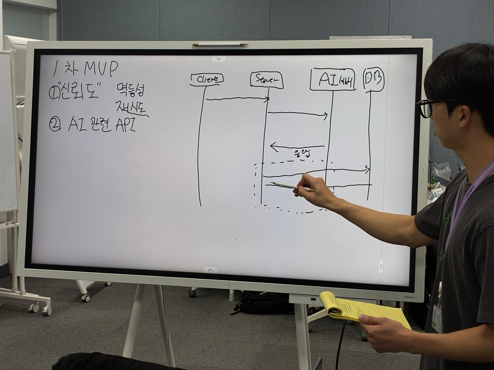
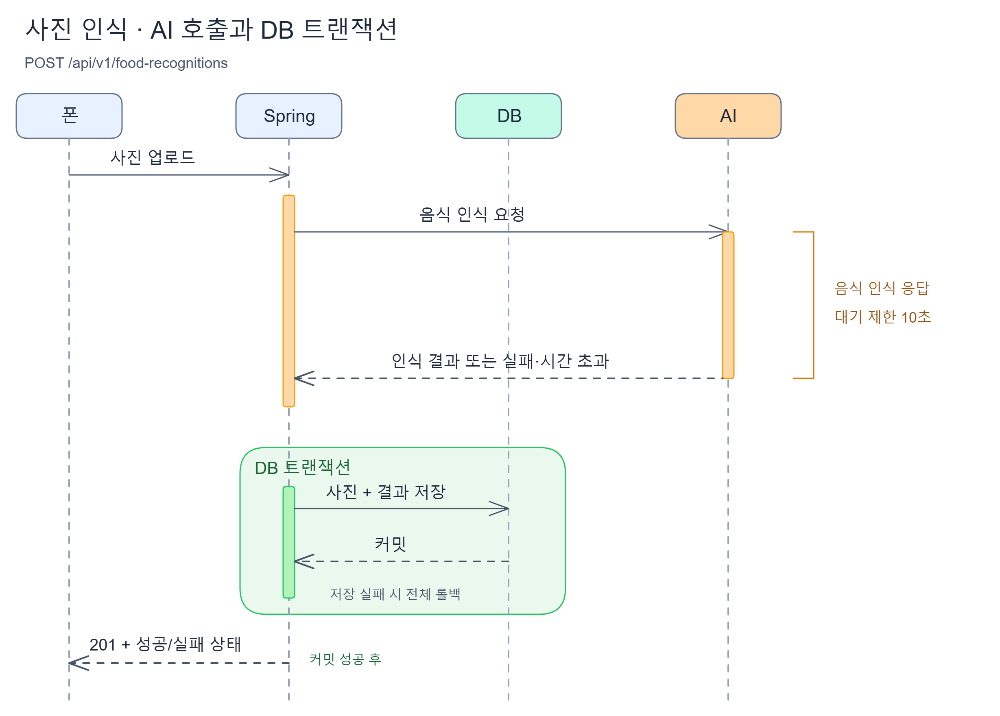

작은 팀에서 제품을 만들다 보면 각자 맡은 일에 깊이 몰입하게 돼요. 빠르게 구현하고 다음 문제를 풀다 보면, 다른 팀원이 무엇을 만들고 어떤 고민을 하는지 알아갈 시간은 따로 내야 하죠.

우리는 **팀원 모두가 제품 전체를 이해하고, 같은 방향으로 판단하며 움직이길 원했어요.** 지금 만드는 기능이 어떤 사용자 문제를 해결하는지, 다른 기능과 어떻게 이어지는지 알아야 각자의 선택도 하나의 제품으로 연결될 수 있으니까요. 무엇을 먼저 만들고 어디에 힘을 쓸지 결정할 때도 그런 공통의 이해가 필요하고요.

그래서 한 주 동안 개발한 기능과 그 안의 고민을 함께 살펴보는 **리뷰데이**를 시작했어요. 각자 구현하며 얻은 이해를 팀 전체의 이해로 넓히고, 다음 한 주도 같은 방향으로 달려가기 위한 시간이에요.

대표 사진처럼 다이어그램을 띄워 놓고 이야기를 나누기도 하고, 보드에 직접 흐름을 그려 가며 설명하기도 했어요.

## 각자 끝까지 만드는 만큼, 흐름은 함께 이해해요

우리 팀은 도메인을 하나씩 맡아 화면부터 API와 테이블까지 구현해요. 하나의 기능을 처음부터 끝까지 책임질 수 있지만, 다른 팀원이 맡은 기능의 내부 흐름을 알아가는 시간도 필요해요.

화면에서 어떤 요청을 보내는지, 서버가 어떤 데이터를 읽고 저장하는지, AI는 어느 시점에 호출되는지. 같은 서비스를 만들고 있어도 직접 구현하지 않은 부분에는 궁금한 점이 생길 수 있죠.

그래서 리뷰데이의 발표 단위는 **구현한 스토리 하나**로 잡으려고 해요. 사용자가 겪는 문제에서 출발해, 그 문제를 해결하는 기능이 실제로 어떻게 동작하는지 따라가는 방식이에요.

## 하나의 스토리를 네 가지 관점으로 살펴봐요

발표를 준비할 때는 다음 네 가지를 중심으로 정리해요.

- **기능 소개**: 어떤 사용자 문제를 해결하는 기능인지 이야기해요.
- **동작 흐름**: 화면에서 시작한 요청이 서버와 DB, AI 등을 거쳐 어떤 응답으로 돌아오는지 설명해요.
- **핵심 구현 판단**: 구현 방식을 선택한 이유와 그 과정에서 고민했던 부분을 나눠요.
- **논의할 내용**: 아직 남아 있는 문제나 팀원들의 의견이 필요한 부분을 꺼내요.

기능이 동작하는 모습에 더해, **왜 그렇게 만들었는지**도 함께 이야기하려고 해요. 선택의 이유를 알아야 다른 기능과 연결할 때 필요한 판단도 함께 할 수 있으니까요.

## 요청과 응답은 그림으로 따라가요

동작 흐름은 Mermaid 시퀀스 다이어그램으로 정리해요. 화면 → 서버 → DB·AI처럼 요청과 응답을 순서대로 따라가면서, 각 부분이 어떤 역할을 맡는지 함께 살펴보는 거예요.

조건 분기나 실패 처리, 상태 변화가 복잡한 기능에는 플로우차트도 추가할 수 있어요. 모든 스토리에 그림을 두 개씩 준비할 필요는 없어요. 설명하려는 흐름에 맞춰 필요한 그림을 고르면 돼요.

*보드에 직접 흐름을 그리면서 각 요청과 응답이 어디로 이어지는지 설명해요.*

## 사진 한 장이 기록으로 남기까지

사진으로 음식을 인식하는 기능을 예로 들어 볼게요. 사용자는 사진을 올리고 결과를 확인하지만, 그 사이에는 서버와 AI, DB가 주고받는 요청이 있어요.

*사진 인식의 대기 시간과 DB 트랜잭션 범위를 나눠 표현한 그림이에요.*

그림에는 AI 서버 연결을 기다리는 시간과 음식 인식 결과를 기다리는 시간이 따로 표시되어 있어요. 사진과 결과를 DB에 저장하는 트랜잭션은 AI 응답을 기다리는 구간 뒤에 시작해요. 저장에 실패하면 전체를 롤백하고, 커밋이 성공한 뒤 사용자에게 응답하는 흐름도 볼 수 있어요.

이렇게 흐름을 펼쳐 놓으면 **어디서 기다리는지, 어디부터 하나의 저장 단위인지**를 함께 짚을 수 있어요. “AI 응답이 늦어지면 어떻게 될까?”, “저장에 실패하면 무엇이 남을까?”처럼 구현 판단과 실패 처리에 관한 질문도 이어갈 수 있고요.

## 진행 중인 기능과 막힌 부분도 가져와요

리뷰데이에는 완성한 기능뿐 아니라 개발 중인 기능이나 막힌 부분도 가져올 수 있어요. 아직 결론을 내리지 못한 구현 방식, 혼자 고민하고 있는 문제도 함께 이야기할 주제예요.

발표 자료를 꾸미는 데 부담을 갖기보다는, 지금까지 만든 흐름과 고민을 팀원들이 이해할 수 있게 공유하는 데 집중하려고 해요. 설명하다가 빠뜨린 부분을 발견할 수도 있고, 듣는 팀원의 질문이 다음 구현의 실마리가 될 수도 있겠죠.

## 함께 이해하는 시간을 쌓아가려고 해요

우리가 리뷰데이에서 쌓고 싶은 건 서로의 개발 흐름에 대한 이해예요. 각자 맡은 기능이 어떻게 이어지는지 알고, 고민이 생겼을 때 함께 이야기할 수 있는 팀이 되고 싶어요.

앞으로도 만든 것과 만들고 있는 것, 그리고 막혀 있는 것까지 나누며 꾸기를 함께 만들어 가려고 해요.
