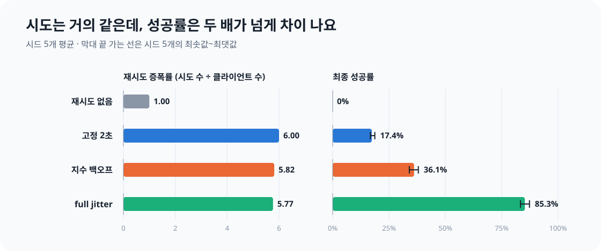
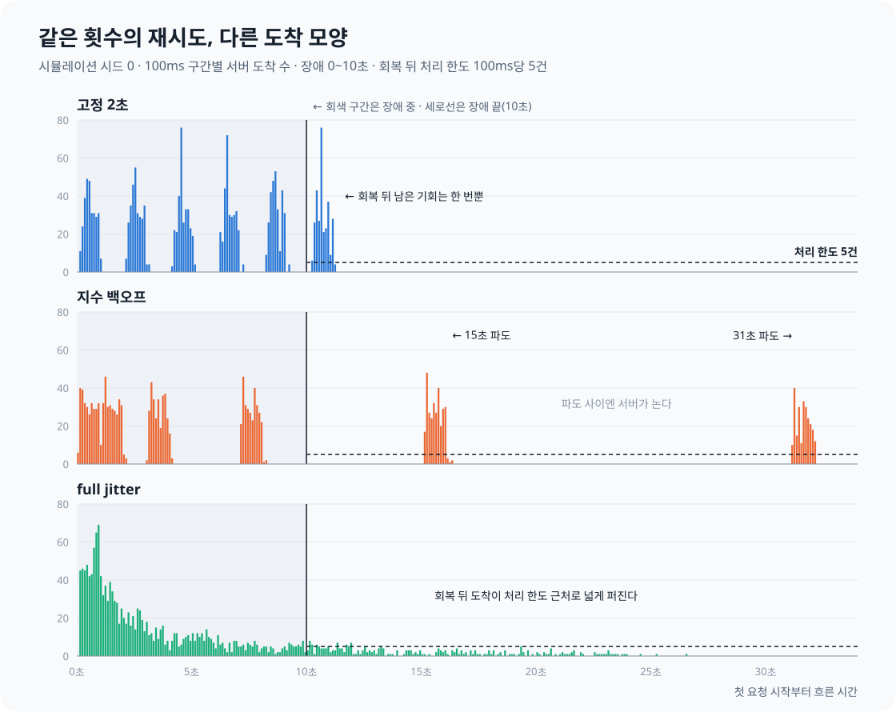
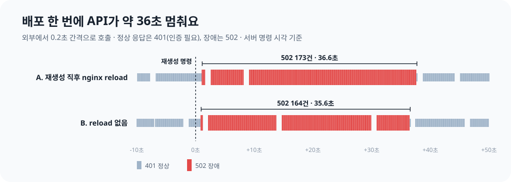

꾸기의 API 규약에는 이런 한 줄이 있었어요.

> 재시도는 지수 백오프 1·2·4초, 최대 3회.

흔히 보는 규칙이고, 처음 적을 때도 별 고민이 없었어요. 그런데 다시 읽어 보니 근거가 하나도 없었어요. 왜 1초에서 시작하는지, 왜 3회인지, 장애가 그보다 길면 어떻게 되는지 설명할 수 없었어요. 지터도 빠져 있었고요.

안녕하세요. 꾸기에서 Web과 AI·ML 개발을 맡고 있는 박시현입니다. 백오프와 지터는 먼저 팀 기술 세미나에서 팀원들과 개념을 함께 살펴봤어요. 이번 글은 그 개념을 꾸기(운동·식단 기록 앱, Android 클라이언트와 Spring 서버)에 직접 구현하면서 **숫자로 확인한 기록**이에요. 재시도와 백오프를 들어 봤지만 실제 수치를 정해 본 적은 없는 분께 도움이 되면 좋겠어요.

먼저 결론부터 말하면 이래요.

**지터는 재시도 횟수를 줄이지 않아요. 같은 횟수의 재시도를 서버가 받을 수 있는 시점으로 흩어 보낼 뿐이에요. 그 차이만으로 최종 성공률이 36%에서 85%로 올랐어요.**

## 같은 장애 조건에서 정책 네 가지를 비교했어요

재시도 정책은 장애가 났을 때만 차이가 드러나요. 실제 서버를 일부러 망가뜨릴 수는 없으니, 같은 장애를 반복해서 만들 수 있는 시뮬레이션부터 만들었어요.

| 항목 | 값 |
| --- | --- |
| 클라이언트 | 300개. 처음 1초 안에 무작위로 한 번씩 요청을 시작해요 |
| 장애 | 처음 10초 동안 서버가 모든 요청에 503을 돌려줘요 |
| 회복 뒤 서버 | 초당 50건(100ms마다 5건)만 받고, 나머지는 즉시 503으로 거절해요 |
| 정책 | 재시도 없음 / 고정 2초 / 지수 백오프 1·2·4·8·16초 / full jitter(기준 1초, 상한 30초) |
| 시도 횟수 | 재시도 없음을 뺀 모든 정책이 최대 6회 |
| 반복 | 시드 5개 |

회복 뒤 서버를 "처리 한도를 넘는 요청은 바로 버리는 서버"로 둔 것은 과부하 상황을 흉내 내기 위해서예요. 회복 직후에 요청이 한꺼번에 몰리면 서버가 다 받지 못하는 상황이 재시도 정책의 차이를 가장 잘 드러내요. 공정하게 비교하려고 시도 횟수는 모두 6회로 맞췄어요.

full jitter는 대기 시간을 0부터 "지수 백오프였다면 기다렸을 시간" 사이에서 고르게 뽑는 방식이에요.

```kotlin
// n번째 실패 뒤 대기: 0 이상, min(상한, 기준 × 2^(n-1)) 미만에서 고르게 고른다
fun fullJitter(failedAttempt: Int, base: Double, cap: Double, random: Random): Double =
    random.nextDouble() * min(cap, base * 2.0.pow(failedAttempt - 1))
```

### 구현에서 신경 쓴 세 가지

시뮬레이션은 Kotlin 단위 테스트로 만들었어요. OkHttp의 `MockWebServer`가 서버 역할을 하고, 스레드 300개가 클라이언트 역할을 해요. 시간은 1/10로 줄여서 논리 1초를 실제 100ms로 돌렸어요. 한 번 돌리는 데 40초쯤 걸려요.

**정책끼리 같은 무작위를 받게 했어요.** 클라이언트마다 `Random(seed * 1_000_003 + index)`로 난수 생성기를 따로 만들었어요. 하나의 난수 생성기를 스레드가 나눠 쓰면 실행 순서에 따라 누가 어떤 값을 받을지 달라져요. 이렇게 나누면 스레드 순서와 관계없이 모든 정책이 같은 시작 시각과 같은 무작위 순서를 받아요.

**숨은 재시도를 막았어요.** OkHttp는 연결에 실패하면 스스로 한 번 더 시도할 수 있어요(`retryOnConnectionFailure`). 이 옵션이 켜져 있으면 정책이 보낸 것보다 많은 요청이 서버에 도착해요. 그래서 옵션을 끄고, **서버가 센 도착 수와 클라이언트가 센 시도 수가 같은지** 매번 검사했어요. 모든 실행에서 두 값이 같았고 IO 오류는 0건이었어요.

**실행을 반복했어요.** 시드 5개로 돌렸고, 같은 설정으로 다른 날 먼저 돌린 실행과도 비교했어요.

## 시도 수는 거의 같았지만, 성공률은 크게 달랐어요

시드 5개의 평균이에요.

| 정책 | 회복 뒤 100ms당 최대 도착 수 | 최종 성공률 | 재시도 증폭률 | 마지막 성공 시각 | 대기 시간 p95 |
| --- | --- | --- | --- | --- | --- |
| 재시도 없음 | 0 | 0% | 1.00 | 없음 | 0초 |
| 고정 2초 | 60.4 (43\~82) | 17.4% | 6.00 | 11.2초 | 10.2초 |
| 지수 1·2·4·8·16초 | 52.6 (47\~64) | 36.1% | 5.82 | 32.2초 | 31.2초 |
| full jitter | 7.8 (7\~9) | 85.3% | 5.77 | 25.9초 | 22.2초 |

재시도 증폭률은 전체 시도 수를 클라이언트 수로 나눈 값이에요. 대기 시간은 클라이언트가 첫 시도부터 성공하거나 포기할 때까지 걸린 시간이고요.


*재시도 증폭률은 거의 같은데 최종 성공률은 크게 달라요.*

지수 백오프와 full jitter의 증폭률은 5.82와 5.77로 거의 같아요. **서버가 받은 요청의 양은 사실상 같았다**는 뜻이에요. 다른 것은 요청이 도착한 시점이에요. 서버의 처리 한도는 100ms당 5건인데, 지수 백오프는 회복 뒤 한 번에 한도의 약 10배를 보냈고, full jitter는 약 1.6배를 보냈어요.

다른 날 먼저 돌린 실행에서도 경향은 같았어요. 성공률은 고정 18%, 지수 34%, full jitter 85%였고, 최대 도착 수는 52.8, 57.0, 8.6이었어요.

## 정책마다 실패한 이유가 달랐어요

성공률보다 흥미로웠던 것은 실패한 이유예요. 정책마다 요청이 도착한 모양을 그려 보면 이유가 보여요.


*시드 0 한 번의 100ms 구간별 도착 수예요. 점선이 서버의 처리 한도(100ms당 5건)예요.*

### 고정 2초: 재시도 예산이 장애 길이와 같았어요

고정 2초 정책의 시도 시각은 시작 후 0, 2, 4, 6, 8, 10초예요. 시작 시각이 0\~1초에 흩어져 있으니 마지막 시도는 10\~11초에 몰려요.

장애가 10초에 끝나므로 클라이언트마다 회복 뒤 기회는 마지막 1회뿐이에요. 그 1초 동안 300개가 몰리고 서버는 50개만 받아요. 50/300 ≈ 17%로 측정값과 맞아요.

문제는 2초라는 간격이 아니었어요. **재시도에 쓸 수 있는 전체 시간이 장애 길이와 같았다**는 것이 문제였어요. 6번의 시도 중 5번이 장애 중에 낭비됐어요.

### 지수 백오프: 서버는 놀고 있었어요

지터 없는 지수 백오프의 시도 시각은 시작 후 0, 1, 3, 7, 15, 31초예요. 같은 순간에 실패한 클라이언트는 다음에도 같은 순간에 다시 보내요. 처음 1초 동안의 퍼짐이 끝까지 그대로 유지되니, 300개가 1초 폭의 파도로 계속 밀려와요.

회복 뒤 파도는 15초와 31초 두 번이고, 파도마다 약 50개가 성공해요. 100/300 ≈ 33%로 측정값 34\~36%와 맞아요.

그래프에서 15초와 31초 사이를 보면 서버는 거의 놀고 있어요. **처리 용량이 모자랐던 게 아니라, 요청이 용량을 쓸 수 없는 시점에 몰렸던 거예요.** 대기 간격을 늘리는 것만으로는 이 문제가 풀리지 않아요. 모두가 같이 늘리니까요.

### full jitter: 퍼짐이 시도마다 커져요

full jitter는 대기를 0부터 상한 사이에서 무작위로 고르기 때문에, 시도할 때마다 클라이언트끼리의 간격이 벌어져요. 회복 뒤 도착이 수십 초에 걸쳐 고르게 퍼져서, 최대 도착 수가 처리 한도 근처(7\~9건)에 머물렀어요.

그래도 15%는 실패했어요. 그래프 앞부분을 보면 장애 중에도 도착이 많아요. 대기를 짧게 뽑은 클라이언트가 장애 중에 시도를 다 써 버린 거예요. 무작위의 대가예요.

성공 1건당 시도 수로 보면 차이가 더 분명해요. 지수 백오프는 약 16회, full jitter는 약 6.8회예요. 보낸 요청 중 쓸모 있었던 비율이 2배 넘게 높아요.

## 실제 배포 중 장애는 36초였어요

시뮬레이션은 "10초 장애"를 가정했어요. 그런데 꾸기에서 미리 예상할 수 있는 장애로 가장 먼저 떠오르는 것은 배포예요. 실제 배포 중에는 API가 얼마나 멈출까요?

앱 서버에서 backend 컨테이너를 같은 이미지로 다시 만들었어요. 코드, DB, 설정은 바꾸지 않았어요.

```bash
docker compose up -d --force-recreate --no-deps backend
```

그동안 외부(개발자 PC)에서 인증이 필요한 API를 0.2초 간격으로 호출했어요. 인증 없이 호출하니 정상이면 401이 오고, 502나 연결 실패가 오면 장애로 셌어요. PC와 서버의 시계 차이(약 0.84초)는 보정했어요.

시나리오는 두 가지예요. 팀 배포 문서에는 "backend를 다시 만들면 nginx가 옛 IP를 들고 있어 502가 날 수 있으니 reload하라"는 경고가 있었어요. 그래서 **A는 문서대로 재생성 직후 nginx를 reload했고, B는 reload하지 않았어요.**

| 시나리오 | 장애 시작 | 복구 | 장애 길이 | 502 응답 수 |
| --- | --- | --- | --- | --- |
| A. 재생성 직후 nginx reload | 명령 +1.1초 | 명령 +37.7초 | 36.6초 | 173 |
| B. reload 없음 | 명령 +0.9초 | 명령 +36.6초 | 35.6초 | 164 |


*막대 하나가 호출 한 번이에요. 중간의 빈틈은 호출 스크립트가 1초쯤 멈춘 구간으로, 장애와는 관계없어요.*

배포 한 번에 API가 약 36초 멈췄어요. backend가 내려간 순간부터 Spring이 다시 뜰 때까지의 기동 시간이에요.

### 예상했던 원인은 원인이 아니었어요

두 번 모두 컨테이너 IP는 그대로였고, reload 여부와 관계없이 장애 길이가 같았어요. **502의 원인은 nginx가 들고 있던 IP가 아니라 Spring의 기동 시간이었어요.**

그렇다고 nginx reload가 쓸모없다는 뜻은 아니에요. IP가 바뀌는 경우에는 여전히 필요해요. 이번 측정에서는 IP가 바뀌지 않았을 뿐이에요.

측정에서 나온 숫자가 하나 더 있어요. 502 응답은 약 70ms 만에 바로 돌아왔어요. 클라이언트는 시간 초과가 아니라 **빠른 실패를 연속으로** 받아요. 대기 없이 재시도하면 시도 횟수가 순식간에 바닥나요.

그리고 실제 장애는 시뮬레이션에서 가정한 10초보다 3배 넘게 길었어요. 이 숫자가 다음 결정으로 이어졌어요.

## 실험 결과를 규칙으로 옮겼어요

full jitter도 대기 시간 p95가 22초였어요. 사용자를 화면에서 22초 기다리게 할 수는 없어요. 게다가 실제 배포 장애는 36초예요. **화면에서 기다리는 요청의 재시도로는 이 장애를 넘길 수 없다**는 결론이 나왔어요.

다행히 꾸기의 요청이 모두 화면에서 결과를 기다리지는 않아요. 운동 기록은 기기에 먼저 저장하고, WorkManager가 백그라운드에서 서버로 보내요. 기록이 기기에 남아 있으니 이쪽은 길게 버텨도 돼요. 그래서 규칙을 둘로 나눴어요.

| 구분 | 대상 | 시도 | 대기 | 한도 | 500 응답 |
| --- | --- | --- | --- | --- | --- |
| 화면 요청 | 사용자가 화면에서 결과를 기다리는 요청 | 최대 3회 | full jitter, 0\~1초 → 0\~2초 | 대기가 끝나는 시각이 첫 요청부터 5초를 넘으면 기다리지 않고 바로 안내 | 재시도 안 함 |
| 백그라운드 전송 | 기기에 먼저 저장하고 WorkManager가 보내는 운동 기록 업로드 | 제한 없음 | full jitter, 기준 30초, 상한 30분 | 없음 | 재시도함 |

백그라운드 전송만 500 응답도 재시도하는 이유는 일시적인 DB 장애도 500으로 나오기 때문이에요. 재시도하지 않으면 운동 기록이 영영 올라가지 않을 수 있어요.

두 규칙에 공통으로 적용하는 조건도 있어요.

- 재시도 대상은 GET과, 멱등 키(클라이언트가 만든 UUID)가 있는 POST뿐이에요. 같은 요청이 두 번 처리돼도 결과가 같아야 재시도할 수 있으니까요.
- 재시도할 실패는 응답이 없는 네트워크 오류와 429, 502, 503, 504예요.
- `Retry-After`가 있으면 **그 값에 지터를 더해** 기다려요. `max(Retry-After, 지터)`처럼 둘 중 큰 값을 쓰면, 지터가 작은 기기는 모두 `Retry-After`만큼만 기다렸다가 같은 순간에 돌아와요. 지수 백오프에서 본 파도가 그대로 다시 생기는 거예요.

규약에서는 모든 수치에 "가정"이라고 표시했어요. 이유는 뒤의 한계에서 이야기할게요.

### 5초 한도는 "끊는다"가 아니라 "새로 시작하지 않는다"예요

화면 요청의 한도는 처음에 8초로 잡았다가 5초로 줄였어요. 3초도 검토했는데, 세 번째 시도를 자주 막아서 사실상 2회가 되기 때문에 뺐어요.

한도의 의미도 고민했어요. 한도를 "진행 중인 요청도 끊는다"로 정하면, 정상 응답이 5초를 넘을 수 있는 사진 인식 요청이 깨져요. 그래서 한도는 **새 재시도를 시작하지 않는 기준**으로만 정했어요. 진행 중인 요청을 언제 끊을지는 요청별 타임아웃으로 따로 정할 거예요.

## 이 실험으로 말할 수 없는 것들

숫자가 있으면 숫자를 실제보다 더 믿게 돼요. 그래서 이 실험의 한계를 정리해 둘게요.

- **상대 비교로만 읽어야 해요.** 시뮬레이션은 한 JVM 안에서 루프백으로 통신했어요. 실제 네트워크 지연이 없어요.
- **최대 도착 수의 절대값에는 잡음이 있어요.** 논리 100ms가 실제 10ms라서 스레드 스케줄링의 영향을 받아요. 다른 실행의 한 시드에서는 지수 백오프가 95로 튀기도 했어요. 의미 있는 것은 "한도의 10배 대 2배 이내"라는 차이의 크기예요.
- **실제 Spring 서버는 다르게 무너질 수 있어요.** 시뮬레이션의 서버는 넘치는 요청을 즉시 버렸어요. 실제 서버는 요청을 큐에 쌓고 느려지는 쪽에 가까워요. 이때 몰림은 503 대신 시간 초과로 나타날 텐데, 아직 확인하지 않았어요.
- **최악의 상황을 가정했어요.** 모든 클라이언트가 동시에 실패하는 경우예요. 실패가 서로 무관하게 드문드문 나면 지터의 효과는 작아요. 부하가 처리량보다 작으면 어떤 정책이든 결국 성공하고요.
- **최종 규칙의 수치를 검증한 것은 아니에요.** 시뮬레이션은 최대 6회로 돌렸고, 최종 규칙은 3회와 30분 상한이에요. 시뮬레이션은 "full jitter를 쓴다"는 결정의 근거이고, 구체적인 수치는 여전히 가정이에요.
- **배포 측정은 시나리오마다 한 번이에요.** 이미지를 새로 빌드하거나 DB 마이그레이션이 있는 배포는 더 길 수 있어요.

솔직히 말하면, 지금 꾸기의 사용자 규모에서 이런 몰림이 일어날 가능성은 낮아요. 그래도 사용자가 늘어난 뒤에 규칙을 바꾸는 것보다, 처음부터 맞는 방향으로 정해 두는 편이 비용이 적다고 판단했어요.

## 정리하며

이번 실험에서 얻은 것을 세 줄로 정리하면 이래요.

1. **지터는 재시도 횟수를 줄이지 않아요.** 증폭률은 5.82와 5.77로 같았어요. 지터는 같은 요청을 서버가 받을 수 있는 시점으로 흩어 보낼 뿐이고, 그것만으로 성공률이 36%에서 85%로 올랐어요.
2. **간격보다 재시도 예산이 중요해요.** 고정 2초는 재시도 시간 전체가 장애 길이와 같아서 시도 대부분을 장애 중에 써 버렸어요.
3. **화면 요청의 재시도로는 긴 장애를 넘길 수 없어요.** 실제 배포 장애는 36초였어요. 긴 장애는 기기에 데이터가 남아 있는 백그라운드 전송이 맡도록 나눴어요.

그리고 "nginx reload를 하라"는 문서의 경고처럼, 팀이 당연하게 믿고 있던 가정도 재 보면 다를 수 있다는 것을 배웠어요.

## 다음에 할 일

- **배포 중 36초 장애 자체를 줄여 보려고 해요.** 기동이 끝난 뒤에 트래픽을 넘기거나, 점검 중에 503과 `Retry-After`를 보내는 방법이에요. 재시도 수치를 다듬는 것보다 효과가 클 거예요.
- **요청별 타임아웃을 정하려고 해요.** 응답 시간 p99를 측정해야 하는데, 사진 인식 모델이 배포된 뒤에 할 수 있어요.
- **실제 Spring 서버로 다시 실험하려고 해요.** 장애 주입 도구(Toxiproxy)를 써서, 서버가 요청을 버리는 대신 느려질 때 정책들이 어떻게 달라지는지 확인할 거예요.
