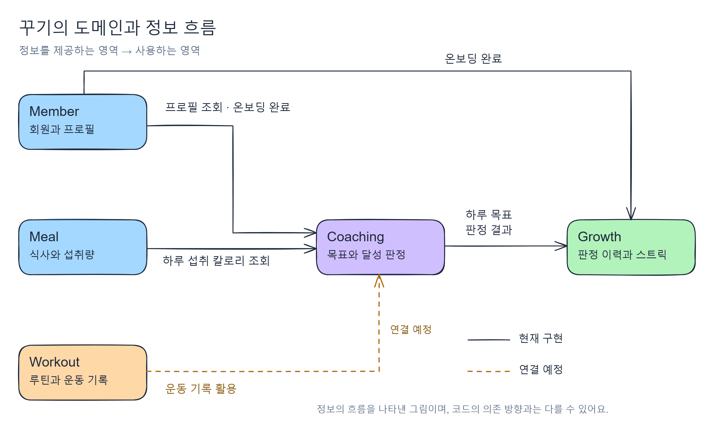

## 들어가며

DDD(Domain-Driven Design)는 소프트웨어가 해결하려는 도메인을 깊이 이해하고, 그 이해를 설계와 코드에 반영하는 개발 접근 방식이에요. 이를 위해 Bounded Context, Aggregate와 같은 설계 개념과 패턴을 제시해요. 하지만 모든 프로젝트에 적용할 수 있는 정해진 설계 절차나 정답이 있는 것은 아니에요. 같은 개념을 사용하더라도 어떤 기준으로 도메인을 나누고, 각 영역에 어떤 책임을 부여할지는 직접 판단해야 해요.

그래서 DDD를 공부하면서 개념 자체는 이해하더라도 실제 프로젝트에 어떻게 적용해야 하는지는 쉽게 와닿지 않았어요. DDD를 설명하는 글마다 강조하는 부분이 다르고, 사람마다 이해하고 적용하는 방식에도 차이가 있다고 느꼈어요.

이번 글에서는 저희 팀이 DDD를 어떻게 이해하고 꾸기 프로젝트에 적용했는지 소개하려고 해요. 도메인을 이해하고 설계하는 과정에서 어떤 고민과 결정을 했으며, 이를 실제 코드에 어떻게 반영했는지 이야기해 볼게요.

## 왜 DDD를 적용했는가?

꾸기(kkugi)는 건강 관리를 꾸준히 이어가기 어려운 사람들을 위한 서비스예요. 식단과 운동을 쉽게 기록하고, 기록을 바탕으로 AI가 개인별 건강 관리 계획을 제공하며, 스트릭과 보상을 통해 지속적인 참여를 유도하는 것을 목표로 하고 있어요.

프로젝트를 시작하면서 DDD를 실제 개발에 적용해보고 싶었고, 꾸기가 다루는 비즈니스 규칙도 복잡해질 수 있다고 생각했어요. 단순히 식단과 운동을 기록하는 데서 끝나는 것이 아니라, 기록을 바탕으로 목표 달성 여부를 판단하고 보상을 제공하는 등 여러 기능이 서로 연결되어 있기 때문이에요.

특히 목표 달성 기준이나 스트릭 유지 조건, 보상 지급 규칙 등은 구현에 앞서 팀원들과 합의해야 할 부분이 많을 것으로 예상했어요. 이러한 규칙이 여러 영역에 걸쳐 있는 만큼, 각 영역이 어떤 개념과 규칙을 책임질지도 중요하다고 생각했어요. 그래서 도메인의 개념과 규칙에 대한 공통의 이해를 만들고, 이를 설계와 코드에 반영하기 위해 DDD를 적용하기로 했어요.

## 꾸기의 도메인 경계

DDD를 적용하기 위해 먼저 요구사항을 문서로 정리하고 팀원들과 함께 검토했어요. 저희는 건강 관리 서비스에 대한 도메인 지식이 충분하지 않았기 때문에, 각자 사용해 본 식단·운동 관리 앱의 경험을 공유하며 필요한 기능과 동작 방식을 논의했어요.

이 과정에서 꾸기가 제공하려는 핵심 경험을 세 가지로 정리했어요. 식단과 운동을 쉽게 **기록**하고, 축적된 기록을 바탕으로 개인별 건강 관리 계획을 제공하는 **코칭**, 그리고 스트릭과 보상을 통해 꾸준히 참여하도록 동기를 부여하는 **성장**이에요.

**기록 → 코칭 → 성장**

DDD에서는 도메인 모델이 일관된 의미를 갖는 범위를 Bounded Context라고 해요. 저희는 위의 흐름에서 각 영역이 어떤 개념을 사용하고 어떤 규칙을 책임져야 하는지 고민했어요. 이를 바탕으로 영역을 구분하고, 초기 Bounded Context의 경계로 삼았어요.

먼저 기록은 식단과 운동으로 구분했어요. 두 기능 모두 사용자의 행동을 기록한다는 공통점이 있지만, 다루는 정보와 사용하는 개념이 달랐기 때문이에요. 식단에서는 무엇을 얼마나 먹었는지가 중요하지만, 운동에서는 운동 강도나 빈도, 휴식 간격 등이 중요했어요. 따라서 각각의 특성에 맞는 모델을 설계하기 위해 Meal과 Workout으로 나누었어요.

Coaching은 축적된 기록을 바탕으로 건강 관리 계획을 생성하고 목표 달성 여부를 판단하는 영역으로 정의했어요. Growth는 목표 달성 결과를 바탕으로 스트릭과 보상을 관리하는 영역으로 구분했어요. 마지막으로 Member는 사용자 정보와 개인별 설정을 관리하는 영역으로 두었어요.

이렇게 Meal, Workout, Coaching, Growth, Member라는 다섯 가지 영역으로 초기 도메인 경계를 정했어요. 각 영역의 책임과 현재 구현된 정보 흐름을 그림으로 표현하면 다음과 같아요.



*화살표는 정보를 제공하는 영역에서 사용하는 영역으로 향해요. 실선은 현재 구현된 연결이고, 점선은 앞으로 연결할 방향이에요. 따라서 이 그림이 코드의 의존 방향을 그대로 나타내는 것은 아니에요.*

도메인의 경계를 정의한 뒤에는 실제 코드에서도 각 영역의 모델이 구분되도록 설계했어요. 예를 들어 Coaching은 건강 관리 계획을 생성하기 위해 Member의 프로필 정보가 필요해요. 이때 Member의 엔티티를 직접 참조하는 대신, Member가 공개한 프로필 값을 받아 자신의 모델로 변환하도록 했어요.

Member는 다음과 같은 프로필 정보를 제공해요.

```java
public record MemberProfileSnapshot(
        String gender,
        LocalDate birthDate,
        BigDecimal heightCm,
        BigDecimal weightKg,
        String healthGoal,
        String activityLevel
) {}
```

Coaching에서는 전달받은 값을 자신의 계산 모델인 `PlanInput`으로 변환해요.

```java
private static PlanInput toInput(MemberProfileSnapshot profile) {
    return new PlanInput(
            Gender.valueOf(profile.gender()),
            profile.birthDate(),
            profile.heightCm(),
            profile.weightKg(),
            HealthGoal.valueOf(profile.healthGoal()),
            ActivityLevel.valueOf(profile.activityLevel())
    );
}
```

이를 통해 Coaching은 Member의 내부 엔티티에 직접 의존하지 않고, 건강 관리 계획을 생성하는 데 필요한 정보를 자신의 모델로 다룰 수 있어요. 물론 공개된 프로필의 필드나 값이 변경되면 영향을 받을 수 있지만, 각 영역의 모델을 구분하려고 했다는 점에 의미가 있어요.

물론 도메인의 경계를 정의했다고 해서 모델링이 끝나는 것은 아니에요. 이후 각 영역의 요구사항을 구체화하면서 새로운 규칙을 발견하고, 해당 규칙을 어느 영역에서 책임져야 하는지 계속 검토했어요.

## 식단 수정에서 발견한 도메인 규칙

각 영역의 요구사항을 구체화하면서 개별 기능뿐만 아니라 다른 영역의 규칙과 어떤 관계가 있는지도 함께 고려했어요. 예를 들어 사용자가 기록한 식단을 수정하는 기능이 있었어요. 일반적인 식단 기록 서비스라면 과거의 기록도 자유롭게 수정할 수 있겠지만, 꾸기에서는 스트릭을 제공하기 때문에 수정 가능한 시점을 결정해야 했어요.

과거의 식단을 언제든지 수정할 수 있다면 이미 달성한 스트릭은 어떻게 처리해야 할까요? 수정한 기록을 기준으로 스트릭을 다시 계산해야 하는지, 이미 달성한 스트릭은 유지해야 하는지와 같은 추가적인 규칙이 필요했어요.

저희는 MVP 단계에서 이러한 복잡성을 줄이기 위해 식단을 당일에만 수정할 수 있도록 결정했어요. 사용자의 수정 자유도는 일부 제한되지만, 과거 기록의 변경이 이미 확정된 결과에 영향을 미치는 상황을 줄일 수 있다고 판단했어요.

이렇게 처음에는 단순히 '식단을 수정할 수 있다'는 요구사항이었지만, Growth의 스트릭 규칙을 함께 고려하면서 '식단은 당일에만 수정할 수 있다'는 구체적인 도메인 규칙을 정의하게 되었어요. 이 규칙은 Meal 모델이 자신의 변경 가능 여부를 직접 판단하도록 코드에 반영했어요.

```java
public void change(
        LocalDateTime eatenAt,
        MealType mealType,
        List<MealItem> items,
        LocalDateTime now) {

    requireChangeAllowed(now);
    apply(eatenAt, mealType, items, now);
}

public void requireChangeAllowed(LocalDateTime now) {
    requireNotDeleted();
    requireToday(now);
}

private void requireToday(LocalDateTime now) {
    if (!eatenAt.toLocalDate().equals(now.toLocalDate())) {
        throw new MealException.PastDayLocked();
    }
}
```

식단을 수정할 때 `Meal`은 먼저 자신의 변경 가능 여부를 확인해요. 삭제된 식단인지 검사하고, 기존 식사 날짜가 오늘이 아니라면 `PastDayLocked` 예외를 발생시켜요.

여기서 `requireToday()`는 수정하려는 새로운 식사 시각이 아니라, **기존 식사의 날짜가 오늘인지** 확인해요. 변경하려는 식사 시각에 대한 추가적인 검증은 `apply()`에서 수행해요. 이렇게 수정 시 지켜야 할 규칙을 Meal 안에 두어, 호출하는 서비스마다 같은 검사를 따로 구현할 필요가 없도록 했어요.

이 사례를 통해 각 영역의 책임을 구분하더라도 서로의 요구사항을 독립적으로만 검토할 수는 없다는 점을 알게 되었어요. 하나의 기능을 구체화하는 과정에서 다른 영역의 규칙까지 고려해야 했고, 이렇게 발견한 규칙을 실제 도메인 모델의 동작에도 반영할 수 있었어요.

## 도메인의 책임을 어디에 둘 것인가?

도메인 규칙을 정의한 다음에는 해당 규칙을 어느 영역에서 책임져야 할지 결정해야 했어요. 대표적인 사례가 목표 달성 여부를 판단하는 기능이었어요. 사용자가 설정한 목표와 실제 기록을 비교하려면 Coaching의 목표 정보와 Meal·Workout의 기록이 모두 필요했어요. 여러 영역의 정보가 필요한 만큼, 어느 쪽에서 판단을 맡을지 고민했어요.

처음에는 기록을 관리하는 Meal과 Workout에서 목표 달성 여부까지 판단하도록 설계할 수도 있다고 생각했어요. 하지만 이렇게 하면 기록을 평가하기 위해 Coaching의 목표 정보를 참조해야 해요. 반대로 Coaching도 건강 관리 계획을 생성하고 관리하기 위해 Meal과 Workout의 기록이 필요했어요. 기록을 관리하는 쪽에 판정 책임까지 두면, 서로의 정보를 참조하는 양방향 의존이 생길 수 있다고 생각했어요.

저희는 목표를 설정하고 관리하는 Coaching이 달성 여부까지 판단하는 것이 더 적절하다고 생각했어요. 목표 달성 여부를 판단하는 일은 사용자가 설정한 목표를 기준으로 기록을 평가하는 일이기 때문이에요. 따라서 Meal과 Workout은 실제 식단과 운동 기록을 관리하고, Coaching은 목표를 기준으로 기록을 평가하며, Growth는 판정 결과를 바탕으로 스트릭을 관리하도록 책임을 구분했어요.

이 책임은 Coaching 안에서 하루 목표를 나타내는 `DailyGoal`에 두었어요. `DailyGoal`의 `judge()`는 하루 섭취 칼로리를 전달받아 자신이 가진 목표 칼로리와 비교하고, 달성 여부를 자신의 상태에 반영하는 메서드예요. Meal은 섭취량을 제공하고, 그 섭취량이 목표를 달성한 것으로 볼 수 있는지는 `DailyGoal`이 판단하도록 했어요.

```java
public class DailyGoal {

    private static final BigDecimal LOWER_RATIO =
            new BigDecimal("0.9");
    private static final BigDecimal UPPER_RATIO =
            new BigDecimal("1.1");

    // 나머지 필드와 생성자 등은 생략했어요.

    public boolean judge(int intakeKcal, LocalDateTime judgedAt) {
        if (isJudged()) {
            return false;
        }

        BigDecimal intake = BigDecimal.valueOf(intakeKcal);

        this.achieved =
                intake.compareTo(targetKcal.multiply(LOWER_RATIO)) >= 0
                        && intake.compareTo(targetKcal.multiply(UPPER_RATIO)) <= 0;

        this.intakeKcal = intakeKcal;
        this.judgedAt = judgedAt;
        return true;
    }

    public boolean isJudged() {
        return achieved != null;
    }
}
```

현재는 섭취 칼로리가 목표의 90~110%에 해당하면 달성으로 인정하고, 한 번 판정한 결과는 유지하도록 했어요. 이 규칙을 목표 칼로리와 판정 결과를 가진 `DailyGoal`에 함께 두었기 때문에, 호출하는 쪽에서는 섭취량을 전달하고 판정을 요청하면 돼요. 목표 달성 기준이나 판정 가능 여부를 호출하는 쪽에서 직접 검사할 필요가 없도록 한 거예요.

판정 이후의 스트릭 계산은 Growth가 맡아요. Coaching은 새로운 판정 결과를 `DailyGoalJudged` 이벤트로 전달하고, Growth는 이 결과를 자신의 스트릭 규칙에 따라 반영해요. 목표가 달성되었는지 판단하는 책임과 그 결과로 스트릭을 갱신하는 책임을 구분한 거예요.

이렇게 책임을 나누면 Meal은 목표 달성 기준을, Coaching은 스트릭 계산 규칙을 알 필요가 없어요. Growth 역시 식단 기록이나 목표 칼로리를 직접 비교하지 않고 판정 결과만으로 자신의 규칙을 적용할 수 있어요. 목표 달성 기준을 바꿀 때는 Coaching의 판정 규칙을, 스트릭 유지 조건을 바꿀 때는 Growth의 계산 규칙을 검토할 수 있도록 변경할 위치도 분명해졌어요.

이 과정에서 도메인의 경계를 나누는 것만큼 각 영역이 어떤 규칙을 책임지는지 결정하는 것도 중요하다고 느꼈어요. 판정에 기록이 필요하다고 해서 기록을 관리하는 쪽이 판정까지 맡아야 하는 것은 아니었어요. 필요한 정보를 어디서 가져오는지와 그 정보를 해석하는 규칙을 어디에 둘지를 함께 고민하면서, 각 개념의 의미에 맞게 책임을 배치하려고 했어요.

## DDD를 적용하며 느낀 점

DDD를 처음 공부할 때는 Bounded Context와 Aggregate 같은 개념을 어떻게 적용해야 하는지에 집중했어요. 하지만 실제 프로젝트에 적용하면서 이러한 개념을 따르는 것 자체보다 도메인을 이해하고, 그 이해를 설계와 코드에 반영하는 것이 더 중요하다고 느꼈어요.

저희는 DDD의 개념과 패턴을 맹목적으로 따르기보다는 도메인을 이해하는 데 초점을 맞췄어요. 요구사항을 검토하면서 명확하지 않았던 규칙을 발견하고, 팀원들과 논의하며 각 영역의 책임을 결정해 나갔어요.

이 과정에서 가장 만족스러웠던 점은 팀원들이 서로의 도메인에 대한 이해를 공유하고 있다는 것이었어요. 개발하면서 의문이 생기거나 합의가 필요한 상황에서 다른 팀원에게 질문하면, 해당 기능을 직접 구현하지 않았더라도 맥락을 이해하고 함께 논의할 수 있었어요.

매주 진행한 [리뷰데이](https://teamyumyum.github.io/posts/review-day/)에서도 이러한 모습을 확인할 수 있었어요. 리뷰데이는 한 주 동안 구현한 기능과 설계 과정에서 내린 결정을 공유하는 자리였어요. 단순히 작업 결과를 발표하는 데 그치지 않고, 다른 팀원이 내린 결정의 배경을 이해하고 질문하며 함께 검토했어요.

물론 DDD의 개념과 패턴을 모두 올바르게 적용했다고 단정할 수는 없어요. 또한 현재의 설계가 정답이라고 생각하지도 않아요. 앞으로 요구사항이 추가되고 변경되면서 지금의 도메인 모델도 달라질 수 있다고 생각해요.

그럼에도 이번 프로젝트에서는 팀원들과 함께 도메인을 이해하고, 서로의 설계 판단을 공유하며, 이를 실제 코드에 반영하려고 했다는 점에 의미가 있었어요. 앞으로도 새로운 요구사항과 규칙을 발견할 때마다 모델을 검토하고 발전시켜 나가려고 해요.
