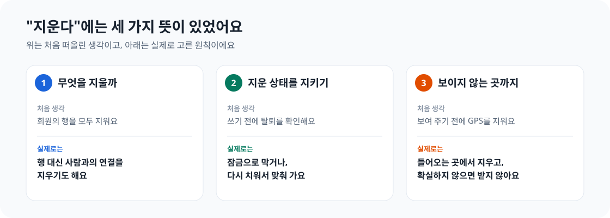
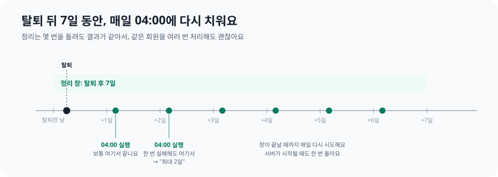
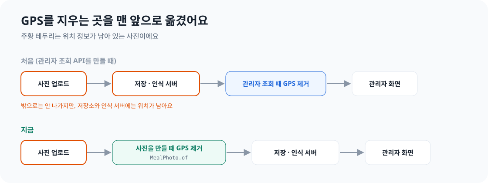

회원 탈퇴는 처음엔 가장 간단한 기능처럼 보였어요. 회원이 "회원 탈퇴"를 누르면 해당 회원의 행을 지우면 되니까요. 테이블마다 `DELETE`를 한 번씩 실행하고, 이벤트 몇 개를 보내면 끝일 줄 알았어요.

안녕하세요. 꾸기에서 Member 도메인을 맡고 있는 설문혁입니다. Play 스토어에 앱을 출시하려면 앱 안에서 회원 탈퇴를 할 수 있어야 하고, 앱 밖의 웹페이지에서도 탈퇴를 요청할 수 있어야 해요. 그래서 이번 주에는 다른 도메인 담당자들과 함께 회원 탈퇴 기능을 만들었어요.

작업을 하다 보니 "삭제"라는 말이 계속 다른 뜻으로 쓰였어요. 세 가지 문제를 풀어야 했고, 매번 처음 떠올린 방법에는 놓친 부분이 있었어요. 이 글에서는 각 문제가 어디서 드러났는지, 어떤 원칙을 세웠는지, 또 어떤 조건이라면 다른 방법을 택할지 이야기해 보려고 해요.

삭제 기능이나 데이터 보관 정책을 만들고 있다면, 또는 "X 이후에는 이 행이 없어야 한다"는 조건을 다루고 있다면 저희가 돌아간 길을 줄이는 데 도움이 되면 좋겠어요.

| "삭제"의 뜻 | 처음 떠올린 방법 | 실제로 마주친 문제 | 정리한 원칙 |
| --- | --- | --- | --- |
| 무엇을 지울까 | 회원의 모든 행을 지운다 | 회원이 떠난 뒤에도 남겨야 할 데이터가 있다 | 행 자체가 아니라 사람과의 연결을 지워야 할 때도 있다 |
| 지운 상태를 어떻게 유지할까 | 쓰기 전에 "탈퇴한 회원인가?"를 확인한다 | 확인을 통과한 요청이 탈퇴 처리 뒤에 커밋된다 | 삭제는 한 번 실행할 작업이 아니라 계속 유지할 상태다 |
| 보이지 않는 곳은 어떻게 지울까 | 사진을 보여 주기 전에 GPS를 제거한다 | 위치 정보가 저장소에도 남고 파일 곳곳에도 숨어 있다 | 민감 정보는 하나의 진입점에서 제거하고, 확신할 수 없으면 fail-closed로 처리한다 |


*이 글의 세 장은 그림의 각 열을 하나씩 다뤄요.*

## 1. 삭제가 언제나 DELETE는 아니에요

### 회원이 떠난 뒤에도 남겨야 하는 데이터

처음 생각은 단순했어요. 회원이 탈퇴하면 회원에게 속한 데이터를 모두 지우는 거예요.

그런데 한 종류의 데이터가 걸렸어요. 회원이 식사 사진을 찍으면 음식 인식 모델이 음식 종류를 예측하고, 회원이 그 결과를 고칠 때가 있어요. 사진, 예측 결과, 수정 내용으로 이뤄진 세트는 모델 재학습에 가장 가치 있는 데이터예요. 모델이 정확히 어디서 틀렸고 정답이 무엇이었는지 담겨 있으니까요.

처음에는 회원이 탈퇴해도 이 데이터를 영구 보관하기로 했어요. 하지만 Play의 계정 삭제 정책과 국내 개인정보 보호법을 다시 읽어 보니, 그 결정을 그대로 유지하기 어려웠어요. 회원이 삭제를 요청한 뒤에도 회원과 연결된 사진을 기한 없이 보관하는 건 정당화하기 어려웠어요.

회원의 개인정보는 지워야 하고, 학습 데이터는 남겨야 했어요. 결정을 다시 열고 세 가지 방법을 비교했어요.

| 선택지 | 처리 방식 | 장점 | 단점 |
| --- | --- | --- | --- |
| 연결된 채로 모두 보관 | 처음 내린 결정 | 학습 데이터가 모두 남는다 | 사진의 주인이 누구인지 여전히 알 수 있다 |
| 모두 삭제 | 회원의 모든 행을 삭제 | 가장 단순하고 명확하다 | 학습과 관리자 검토에 쓰는 사진 세트도 사라진다 |
| **연결을 끊고 보관** | 사진 세트에서 회원 ID만 지우고 나머지 데이터는 삭제 | 탈퇴 처리와 학습 데이터 보관을 함께 충족한다 | DB 제약 조건과 동시성 처리가 복잡해진다 |

저희는 세 번째 방법을 택했어요. 핵심은 행 자체보다 **그 행이 누구와 연결돼 있는지**였어요. 회원 ID를 지우면 사진 세트만으로는 누가 찍었는지 알 수 없어요. 이렇게 행을 지우는 대신 사람과의 연결을 끊는 게 비식별화예요. 회원에게 속한 나머지 데이터는 그대로 삭제하고, 이 처리 방식을 개인정보처리방침과 회원 탈퇴 페이지에도 명시했어요.


*각 도메인이 `MemberWithdrawn` 이벤트를 받아 자기 데이터를 처리해요. Member가 다른 도메인의 삭제 기능을 직접 호출하지는 않아요.*

하지만 연결을 끊으려면 기존에 의지하던 두 가지를 다시 살펴봐야 했어요.

### 제약을 풀었다면 더 정확한 제약을 세워야 해요

식사 테이블의 `member_id` 열에는 `NOT NULL` 제약이 있었어요. 회원과의 연결을 끊으려면 `NULL`을 허용해야 했어요.

그냥 `NOT NULL`만 없애면 사진이 없는 식사에도 주인이 없을 수 있어요. 그런 행은 누구에게도 속하지 않고 쓸모도 없어요. 제약을 없애면 원하던 경우만 허용하는 게 아니라 다른 경우까지 모두 허용하게 돼요.

그래서 규칙을 없애는 대신 범위를 좁혔어요. **사진 인식 결과와 연결된 식사에만 회원이 없을 수 있다**고 정했어요. 어떤 코드 경로에서도 실수로 주인 없는 식사를 만들지 못하도록 DB가 직접 검사하게 했어요.

```sql
ALTER TABLE meal
    ADD CONSTRAINT ck_meal_member_id_or_photo
    CHECK (member_id IS NOT NULL OR photo_recognition_id IS NOT NULL);
```

### 일괄 UPDATE는 낙관적 잠금을 건너뛰어요

두 번째 문제는 더 눈에 띄지 않았어요. 연결을 끊는 코드는 한 줄짜리 일괄 UPDATE인데, 이번 기능에서 제가 가장 오래 들여다본 코드이기도 해요.

```java
@Modifying(flushAutomatically = true, clearAutomatically = true)
@Query("update Meal m set m.memberId = null, m.version = m.version + 1"
        + " where m.memberId = :memberId and m.photoRecognitionId is not null")
int clearMemberIdOfPhotoMeals(@Param("memberId") long memberId);
```

`m.version = m.version + 1`을 봐 주세요. 이 부분이 없으면 이런 일이 생길 수 있어요. 회원이 탈퇴하기 직전, 다른 기기에서 식사를 수정하려고 조회해요. 그사이 탈퇴 처리가 회원 ID를 지워요. 이후 수정 요청이 저장되면 Hibernate가 처음 읽어 온 엔티티를 이전 회원 ID와 함께 다시 써서 **끊어 놓은 연결이 되살아나요.**

보통은 낙관적 잠금이 이를 막아요. JPA는 저장할 때 `@Version` 열을 비교하고, 다른 요청이 행을 바꿨다면 저장에 실패해요. 하지만 JPQL 일괄 UPDATE는 DB에 바로 반영하면서 `@Version`을 바꾸지 않아요. 수정 요청에서는 행이 바뀐 줄 알 수 없죠. 그래서 일괄 UPDATE에서 버전을 직접 올렸어요. 이제 수정 요청은 버전 검사에서 실패하고, 끊은 연결도 그대로 유지돼요.

삭제 기능에만 해당하는 문제는 아니에요. 일반적인 변경 감지로도 수정하는 엔티티에 일괄 UPDATE를 실행한다면, 버전도 함께 올려야 이전에 읽은 엔티티가 변경 내용을 덮어쓰지 않아요.

### 다른 방법을 택해야 할 때

연결을 끊는 방법은 남은 데이터만으로 사람을 알아낼 수 없을 때만 쓸 수 있어요. 사진에 얼굴이 보이거나 촬영 시각과 위치를 조합해 사람을 찾을 수 있다면, 회원 ID만 지워서는 비식별화가 아니에요. 그럴 때는 데이터를 삭제해야 해요. 3장에서 설명할 사진의 위치 정보를 저장 전에 제거한 이유도 여기에 있어요. 남길 데이터를 실제로 쓸 계획이 없다면 삭제하는 편이 낫고요. 삭제 기능에서는 단순함도 큰 장점이에요.

## 2. 지운 데이터가 다시 생겨요

### 확인과 쓰기 사이의 틈

탈퇴 처리는 이벤트로 진행돼요. 탈퇴가 커밋되면 각 도메인이 이벤트를 받아 자기 데이터를 삭제해요. 탈퇴한 회원의 토큰도 즉시 막기 때문에, 탈퇴 이후에 시작한 요청은 서버까지 도달하지 못해요.

문제는 탈퇴 **직전에** 시작한 요청이에요. 회원이 다른 기기에서 식사 사진 업로드를 시작한 직후 탈퇴했다고 해 볼게요. 업로드 요청은 이미 인증과 회원 확인을 통과했고, 사진 인식 서버의 응답을 몇 초째 기다리고 있어요. 그사이 탈퇴가 커밋되고 데이터 삭제도 끝나요. 이후 업로드 요청이 커밋되면 **탈퇴한 회원 ID가 들어 있는 새 행이 생겨요.**


*업로드가 시작될 때는 아직 탈퇴 전이라 회원 확인을 통과해요.*

쓰기 직전에 탈퇴 여부를 한 번 더 확인하면 될 것 같아요. 하지만 그 확인과 쓰기 사이에도 틈이 있어요. 확인할 때는 활성 회원이었어도 쓰는 순간에는 탈퇴한 회원일 수 있죠. 확인을 더 넣으면 틈은 줄어들지만 없어지지는 않아요. 확인한 값이 실제 동작을 실행할 때까지 바뀔 수 있는, 이른바 check-then-act 문제예요.

### 두 가지 방법: 순서를 보장하거나, 나중에 정리하거나

이 틈을 다루는 방법은 두 가지예요.

첫째는 **확인과 쓰기를 같은 잠금 안에서 처리하는 방법**이에요. 탈퇴와 쓰기가 중간에 끼어들 수 없어서 틈이 사라져요. 둘째는 **틈을 인정하고 나중에 정리하는 방법**이에요. 늦게 들어온 행은 일단 저장하고, 여러 번 실행해도 결과가 같은 정리 작업으로 뒤에서 지워요.

어느 쪽을 고를지는 두 가지를 봐야 해요. 잘못된 상태가 잠깐이라도 보여도 되는지, 모든 쓰기 경로에 잠금을 넣는 비용이 얼마나 큰지예요. 꾸기에서는 Growth에만 회원별 잠금이 이미 있어서 도메인마다 다르게 처리했어요.

| 도메인 | 처리 방법 | 이유 |
| --- | --- | --- |
| Growth | 회원별 잠금을 잡은 직후 탈퇴 여부 확인 | 이미 있는 잠금 안에서 확인하면 거의 비용 없이 틈을 막을 수 있다 |
| Meal · Workout · Coaching | 알려진 한계로 기록하고 매일 정리 | 새 잠금을 넣으려면 모든 쓰기 경로를 바꿔야 하고, 삭제 실패에 대비한 정리 작업도 여전히 필요하다 |

Growth는 판정 결과를 반영할 때마다 먼저 회원별 잠금 행을 잠가요. 잠금을 잡은 직후 탈퇴 여부를 확인하고, 탈퇴했다면 아무것도 쓰지 않고 해당 회원의 Growth 데이터를 지워요.

```java
private boolean lockActiveMember(Long memberId) {
    boolean locked = memberLockRepository.findForUpdateByMemberId(memberId).isPresent();
    if (memberStatus.isWithdrawn(memberId)) {
        eraseLocked(memberId); // 쓰지 않고, 방금 잡은 잠금 행까지 지운다
        return false;
    }
    // ...
}
```

### 다시 실행해도 안전한 정리 작업

Meal, Workout, Coaching에는 한국 시간으로 매일 04:00, 그리고 서버가 시작할 때 정리 작업을 실행해요. **최근 7일 안에 탈퇴한 모든 회원**에게 같은 삭제 작업을 다시 실행해요.

```java
@Scheduled(cron = "0 0 4 * * *", zone = "Asia/Seoul")
public void daily() { run(); }

@EventListener(ApplicationReadyEvent.class)
public void onStartup() { run(); }
```


*기간은 Member의 조회 쿼리 한 곳에서 정해 네 도메인이 같은 값을 사용해요.*

이 방식에는 몇 가지 결정이 담겨 있어요.

- **기간을 길게 잡을 필요는 없어요.** 늦은 쓰기는 탈퇴 전에 시작한 요청이 아직 실행 중일 때만 생겨요. 길어도 몇 분이어서 7일이면 넉넉해요.
- **모든 단계가 멱등이에요.** 멱등은 여러 번 실행해도 결과가 같다는 뜻이에요. 각 정리 단계는 "이 회원 ID를 가진 행을 삭제한다" 같은 일괄 문장이에요. 행이 이미 없다면 아무 일도 일어나지 않아요. 이벤트 처리가 실패한 회원도 기간이 끝날 때까지 매일 다시 처리할 수 있어요.
- **한 건이 실패해도 나머지는 계속해요.** 회원마다 별도 트랜잭션으로 정리해서 실패한 회원의 작업만 롤백하고 오류 로그를 남겨요.
- **지금은 분산 잠금을 두지 않았어요.** 서버가 한 대이고, 작업을 두 번 실행해도 결과가 같아요. 서버를 늘릴 때 다시 살펴볼 예정이에요.

이 구조를 정한 뒤 개인정보처리방침에 **"탈퇴 후 최대 2일 이내 처리"**라고 구체적으로 적을 수 있었어요. 보통 다음 04:00 작업에서 끝나고, 그 작업이 실패해도 그다음 날 다시 처리해요.

여기서 배운 건 동시 요청이 있는 시스템에서 **삭제는 한 번 실행할 작업이 아니라 계속 지켜야 하는 상태**라는 점이에요. 비동기 쓰기가 진행되는 동안 데이터를 지우는 상황이라면 비슷한 문제가 생겨요. 소프트 삭제, 캐시 무효화, 이벤트 기반 정리도 마찬가지예요. 쓰기와 삭제의 순서를 잠금으로 보장하거나, 삭제를 반복할 수 있게 만들어 계속 실행해야 해요.

### 다른 방법을 택해야 할 때

회원별 잠금은 하나의 DB에 있고, 정리 작업은 서버 한 대를 전제로 해요. 서버가 여러 대라면 작업에 DB 수준 잠금이나 분산 잠금을 고려해야 해요. 결제나 법적 기록처럼 잘못된 상태가 잠깐이라도 생기면 안 되는 경우에는 나중에 정리하는 방법만으로 부족해요. 모든 쓰기 경로에서 잠금 안에서 탈퇴 표시를 확인해야 해요.

## 3. 데이터는 보지 않는 곳에도 숨어 있어요

### 나갈 때 제거하면 늦어요

휴대전화로 찍은 사진에는 촬영 위치가 들어 있는 경우가 많아요. 위도와 경도는 EXIF라는 파일 메타데이터 영역에 기록되고, 사진에 따라 XMP라는 다른 영역에도 들어가요. 식사 사진은 집에서 찍을 때가 많아서 위치가 남아 있으면 회원의 집 주소를 드러낼 수 있어요.

처음 이 문제를 다룬 건 관리자 검토 화면을 만들 때였어요. 관리자는 회원이 수정한 사진 세트를 보고 학습에 쓸 수 있는지 판단해요. 관리자에게 보여 주는 사진에는 위치가 없어야 하니, 처음에는 **관리자 화면에 사진을 보여 줄 때** GPS를 제거했어요.

민감한 정보가 시스템 밖으로 나가기 직전에 지우면 될 것 같았어요. 그런데 개인정보처리방침을 쓰면서 원본 사진에는 위치가 남은 채 저장돼 있고, 인식 서버에도 그대로 전달됐다는 걸 알았어요. "원본 사진을 위치 정보와 함께 저장한다"고 고지할 수도 있었어요. 저희는 대신 **"위치 정보를 저장하지 않는다"**고 약속하기로 하고, 제거 시점을 맨 앞으로 옮겼어요.


*사진 객체를 만드는 `MealPhoto.of`가 사진이 서버로 들어오는 유일한 경로예요. 여기서 제거하면 어느 경로도 빠뜨릴 수 없어요.*

원칙은 **나갈 때가 아니라 들어올 때 민감 정보를 제거하는 것**이에요. 나가는 곳마다 제거하면 새 경로가 생길 때마다 빠뜨릴 수 있어요. 하나의 진입점에서 제거하면 이후 경로에서는 위치가 없는 사진만 다루게 돼요. 어려운 부분은 그 진입점을 찾거나 만드는 일이에요.

### 이미지를 다시 그리지 않고 바이트를 수정해요

GPS를 제거하는 가장 쉬운 방법은 이미지 라이브러리로 사진을 읽어 다시 저장하는 거예요. 그러면 메타데이터가 모두 사라져요. 하지만 다시 인코딩하면 화질이 달라지고 회전 방향 태그도 사라져 사진이 옆으로 누워 보일 수 있어요.

그래서 파일 구조를 직접 읽고 **GPS 항목만 제거했어요.** JPEG의 APP1 세그먼트, PNG의 `eXIf` 청크, WebP의 `EXIF` 청크에서 EXIF 블록을 찾아요. 그 안에서 GPS 데이터를 가리키는 항목을 없애고, GPS 값이 있던 바이트는 0으로 덮어요. 파일 길이와 다른 오프셋은 그대로라 나머지 태그에는 손대지 않아요. PNG는 청크마다 CRC라는 체크섬이 있어서 JDK의 `CRC32`로 다시 계산했어요. 새 라이브러리는 추가하지 않았어요.

### 확신할 수 없다면 fail-closed로 처리해요

여기서 가장 중요하게 세운 규칙은 **fail-closed**예요. 위치를 확실히 제거했다고 말할 수 없다면 더 넓은 범위를 지우거나 사진을 아예 받지 않아요.


*EXIF 블록을 통째로 지우면 회전 방향 태그도 사라져요. 그래도 위치가 노출되는 것보다는 낫다고 판단했어요.*

코드에서는 사진 객체를 만드는 순간 이 결정을 끝내요. 파일 구조를 읽을 수 없다면 GPS가 없는지도 확인할 수 없으니 415로 거부해요.

```java
public static MealPhoto of(byte[] content) {
    // 빈 파일 → 10MB 초과 → 형식(JPEG·PNG·WebP) 순서로 먼저 거른다
    // ...
    try {
        return new MealPhoto(format, PhotoGpsRemover.remove(content, format));
    } catch (PhotoGpsRemover.BrokenPhotoException e) {
        throw new BusinessException(ErrorCode.UNSUPPORTED_MEDIA_TYPE, "사진 파일을 읽을 수 없다");
    }
}
```

코드 리뷰에서는 놓친 곳이 더 나왔어요. PNG의 압축 XMP 청크와 `Raw profile type` 텍스트 청크, JPEG의 Extended XMP, 첫 이미지 뒤에 동영상이 붙는 모션 포토 같은 파일이 있었어요. 위치가 숨을 수 있는 곳이 예상보다 훨씬 많았어요. 읽을 수 없거나 확신할 수 없다면 블록 전체를 버린다는 같은 규칙으로 모두 처리했어요.

관리자 화면에서 GPS를 제거하는 기존 처리도 남겼어요. 변경 전에 저장한 사진에는 위치가 남아 있을 수 있으니까요. 이미 제거한 사진을 다시 처리해도 결과는 같아서 새 사진에도 문제없어요.

### 다른 방법을 택해야 할 때

지원하는 형식이 늘수록 파일 구조를 직접 해석하는 비용도 커져요. HEIC나 AVIF까지 받아야 한다면, 충분히 검증된 라이브러리로 이미지를 다시 인코딩하는 편이 나을 수 있어요. 인코딩 전에 회전 방향을 픽셀에 적용하면 사진이 옆으로 눕는 문제도 피할 수 있어요.

## 마무리: 삭제 기능을 만들 때 확인할 다섯 가지

돌아보면 "삭제"라는 단어만으로는 세 가지 문제가 보이지 않았어요. 요구사항을 다시 읽거나 동시 요청을 따져 볼 때 비로소 드러났어요. 다음에 삭제 기능을 만든다면 처음부터 이 다섯 가지를 확인할 것 같아요.

1. **어떤 데이터는 완전히 지워야 하고, 어떤 데이터는 사람과의 연결만 끊어도 될까요?** 남은 데이터만으로도 그 사람을 알아낼 수 있나요?
2. **제약을 풀었다면 어떤 더 정확한 제약으로 바꿀까요?** `NOT NULL`만 없애지 말고, 언제 비워도 되는지 정해 DB가 검사하게 해야 해요.
3. **동시성 제어를 건너뛰는 일괄 UPDATE가 있나요?** JPQL 일괄 UPDATE는 `@Version`을 바꾸지 않아요. 버전을 직접 올려야 해요.
4. **확인과 쓰기 사이에 틈이 있나요?** 잠금으로 막거나, 반복해도 안전한 정리 작업으로 메워야 해요. 확인을 더 넣는 것만으로는 틈이 없어지지 않아요.
5. **민감 정보를 하나의 진입점에서 제거하나요? 제거했는지 확신할 수 없다면 어떻게 하나요?** fail-closed로 처리해야 해요.

선택하지 않은 방법들이 틀렸던 건 아니에요. 모두 삭제했다면 더 단순했을 테고, 쓰기 전에 매번 확인하는 방법도 자연스럽게 느껴졌어요. 다만 꾸기가 회원에게 하는 약속과 지금 팀이 유지할 수 있는 복잡도를 함께 놓고 보니, 이번에 고른 방법이 조금 더 잘 맞았어요.

## 다음에 할 일

- **정리 작업 실패 알림.** 지금은 정리가 실패해도 오류 로그만 남아요. 같은 회원의 처리가 7일 동안 계속 실패한다면 담당자가 알 수 있어야 해요.
- **서버를 늘릴 때 잠금 방식 재검토.** 서버가 한 대인 지금은 분산 잠금이 필요 없지만, 서버를 늘리면 다시 판단해야 해요.
- **워치에 남은 기록 정리.** 전송하지 않은 운동 기록도 탈퇴 시 워치에서 삭제해야 한다는 규칙을 정했고, 구현은 워치 동기화 작업에 넘겼어요.