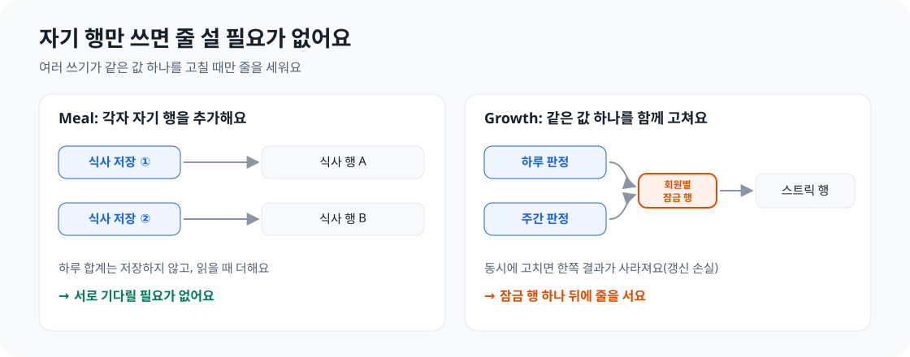
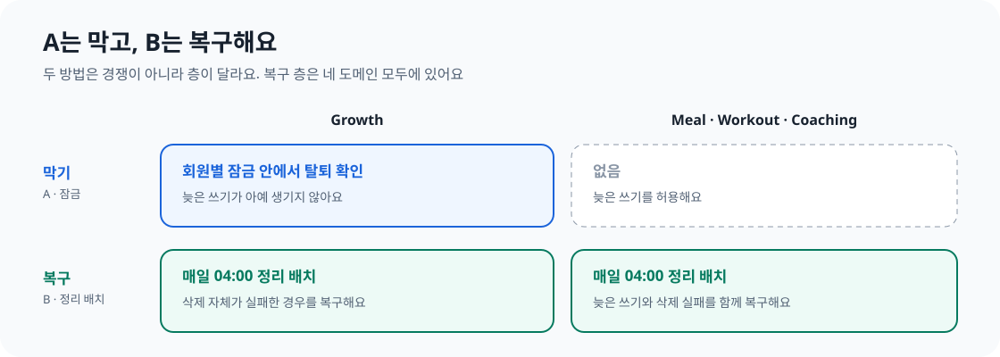

회원 탈퇴 기능을 만든 뒤, 삭제했던 탈퇴 회원의 데이터가 다시 생기는 경우를 발견했어요. 삭제 로직 자체에는 문제가 없었어요. 원인은 check-then-act, 즉 TOCTOU라고 부르는 동시성 문제였어요.

안녕하세요. 꾸기에서 Member 도메인을 맡고 있는 설문혁입니다. 이번 글에서는 문제를 어떻게 발견했는지, 먼저 떠오르는 해결책이 왜 통하지 않는지, 실제로 적용할 수 있는 두 가지 방법은 무엇인지 이야기해 보려고 해요. 그리고 한 도메인에는 잠금을, 나머지 세 도메인에는 나중에 다시 삭제하는 방식을 선택한 이유도 살펴볼게요.

## 1. 배경: 탈퇴하면 데이터를 삭제하거나 연결을 끊어요

회원이 탈퇴하면 프로필, 사진이 없는 식사 기록, 운동 기록, 코칭 계획, 체중 기록, 스트릭 등 대부분의 데이터를 삭제해요.

한 가지는 남겨요. 식사 사진과 모델의 예측 결과, 회원이 수정한 내용이에요. 이 데이터에는 음식 인식 모델이 어디서 틀렸고 정답은 무엇인지 담겨 있어 재학습에 가장 가치 있는 자료예요. 하지만 회원과 연결된 채로 보관하면 Google Play의 계정 삭제 정책과 국내 개인정보 보호법에 어긋날 수 있어요. 그래서 해당 행에서 회원 ID만 제거하고 나머지는 보관해요. 그러면 누구의 기록인지 알 수 없어요. 이를 비식별화라고 해요.


*각 도메인이 탈퇴 이벤트를 받아 자기 데이터를 처리해요.*

개인정보처리방침에서 회원에게 한 약속은 한 문장으로 정리할 수 있어요. 회원이 탈퇴한 뒤에는 해당 회원의 모든 행을 삭제하거나 회원과의 연결을 끊어요. 즉, **탈퇴한 회원의 ID가 들어 있는 행은 하나도 남으면 안 돼요.** 이 문장을 기억해 주세요. 이 글에서는 이 약속이 깨진 사례 하나를 살펴볼게요.

## 2. 문제: 지운 데이터가 다시 생겼어요

꾸기의 회원 탈퇴는 이벤트로 처리해요. 탈퇴 트랜잭션이 커밋되면 Member가 `MemberWithdrawn` 이벤트를 발행하고, 커밋 이후 각 도메인이 새 트랜잭션에서 자기 데이터를 삭제해요. 도메인끼리 서로의 상태를 직접 바꾸지 않고 이벤트로 변경을 알려요. 탈퇴 회원의 토큰은 즉시 차단하므로 탈퇴 이후에 시작한 요청은 서버까지 도달하지 못해요.

문제는 탈퇴 **직전에** 시작한 요청이에요. 회원이 다른 기기에서 식사 사진을 올린 직후 탈퇴했다고 해볼게요. 업로드 요청은 이미 회원 확인을 통과했고, 사진 인식 서버의 응답을 몇 초 동안 기다리고 있어요. 그사이 탈퇴 트랜잭션이 커밋되고 데이터 삭제까지 끝나요. 그런데 그다음 업로드 요청이 커밋되면서 탈퇴 회원 ID를 가진 새 행이 생겨요.


*업로드를 시작할 때는 아직 탈퇴 전이어서 회원 확인을 통과해요.*

이 행에는 탈퇴한 회원의 ID가 그대로 들어 있어요. 앞에서 말한 약속, "탈퇴한 회원의 ID가 들어 있는 행은 하나도 남지 않는다"가 깨진 거예요.

### 왜 데이터베이스가 막아주지 못했을까요?

여기서 생긴 건 삭제했던 행이 되살아난 게 아니라 **새 행이 INSERT된 것**이에요. 따라서 삭제 방식과는 관계가 없어요. 모든 행을 완전히 삭제하는 정책이었다 해도, 이 INSERT로 같은 행이 다시 생겼을 거예요.

그렇다면 데이터베이스가 탈퇴한 회원의 INSERT를 거부할 수는 없을까요? 식사 테이블에 회원 테이블을 참조하는 외래 키가 있고 회원 행도 삭제됐다면 가능해요. 하지만 꾸기는 두 조건 모두 해당하지 않아요.

- **탈퇴해도 회원 행은 삭제하지 않아요.** 개인정보를 제거한 뒤 `DEACTIVATED` 상태로 남겨둬요. 그래서 새 행의 회원 ID가 가리키는 행은 여전히 존재해요.
- **도메인을 가로지르는 외래 키는 선언하지 않아요.** 도메인 경계를 넘는 참조는 `member_id`처럼 ID 값만 저장해요. 마이그레이션에서 회원 테이블을 참조하는 외래 키는 프로필, 소셜 계정처럼 Member 도메인 안의 테이블에만 있어요. Meal의 `member_id`에는 외래 키가 없어요.

그래서 데이터베이스는 이 INSERT를 그대로 받아들여요. 탈퇴 후 데이터가 다시 생기지 않게 하는 건 코드의 몫이에요.

## 3. 원인: check-then-act

### check-then-act란 무엇인가요?

온라인 쇼핑몰에서 두 사람이 거의 동시에 마지막 남은 상품을 주문한다고 해볼게요. 서버는 각 주문을 처리할 때마다 "재고가 남아 있나?"를 확인하고, 남아 있으면 상품을 판매해요.

| 단계 | 주문 A | 주문 B | 재고 |
| --- | --- | --- | --- |
| ① | 재고 확인 → 1개 남음, 구매 가능 | | 1 |
| ② | | 재고 확인 → 1개 남음, 구매 가능 | 1 |
| ③ | 판매 | | 0 |
| ④ | | 판매 | **-1** |

A와 B 모두 잘못한 건 없어요. 둘 다 재고를 확인했고, 확인한 시점에는 실제로 상품이 1개 남아 있었어요. 문제는 **B가 ②에서 재고를 확인한 뒤 ④에서 판매하기 전에 A가 마지막 상품을 가져갔다는 점이에요.** B는 상태가 바뀐 줄 모르고 ②에서 확인한 결과대로 판매했어요.

이처럼 상태를 확인한 뒤 그 결과에 따라 행동하는 흐름을 check-then-act라고 해요. 확인과 실행 사이에 다른 요청이 상태를 바꿔서 생기는 문제를 TOCTOU(time of check to time of use)라고 해요.

꾸기에서 일어난 일도 표로 그려보면 같은 모습이에요.

| 단계 | 사진 업로드 요청 | 탈퇴 | 식사 테이블 |
| --- | --- | --- | --- |
| ① | 회원 확인 → 활동 중, 저장 가능 | | |
| ② | 사진 인식 서버 응답 대기 중 … | 탈퇴 커밋 | |
| ③ | … | 회원 데이터 삭제 | 회원 7의 행 0개 |
| ④ | 식사 저장 | | **회원 7의 행 1개** |

업로드 요청이 ①에서 확인했을 때 회원은 실제로 활동 중이었어요. 하지만 ①과 ④ 사이에 탈퇴가 처리됐어요. 재고 예시의 -1은 꾸기에서 탈퇴한 회원의 행이 남는 문제로 나타난 거예요.

### "저장 직전에 한 번 더 확인"해도 해결되지 않아요

가장 먼저 떠오르는 방법은 저장 직전에 다시 확인하는 거예요. 하지만 두 번째 확인과 저장 사이에도 틈이 있어요. 확인할 때는 활성 회원이었다가 저장할 때는 탈퇴한 상태일 수 있죠. 확인을 늘리면 틈은 줄어들지만 없어지지는 않아요. 확인과 쓰기가 별도 단계인 이상, 그사이에 다른 트랜잭션이 끼어들 수 있어요.

check-then-act 문제를 해결하려면 두 가지 방법 중 하나가 필요해요.

1. **조건을 깨는 작업과 맞물려, 확인과 실행이 한꺼번에 이루어지도록 해요.** 실제로는 쓰기와 삭제가 같은 잠금을 잡아 서로 중간에 끼어들지 못하게 해요.
2. **지난 상태를 바탕으로 쓰기가 일어날 수 있음을 받아들이고, 나중에 결과를 되돌려요.** 실제로는 나중에 삭제를 다시 실행해요.

이 글에서는 각각 A(막기), B(고치기)라고 부를게요.

## 4. 실제로 통하는 두 가지 방법

### A. 막기: 삭제와 같은 잠금 안에서 확인하고 쓰기

A가 동작하려면 두 조건을 모두 만족해야 해요.

- **쓰기와 삭제가 같은 대상을 잠가야 해요.** 쓰기만 잠그면 삭제가 그사이에 실행될 수 있어요.
- **잠금을 잡은 뒤에 확인해야 해요.** 잠금을 잡기 전에 확인하면 여전히 틈이 남아요.

두 조건을 만족하면 어느 쪽이 먼저 잠금을 잡아도 괜찮아요. 쓰기가 먼저 잡으면 쓰고 커밋해요. 기다리던 삭제가 이어서 새 행까지 모두 지워요. 삭제가 먼저 잡으면 삭제하고 커밋해요. 기다리던 쓰기는 회원이 탈퇴한 것을 확인하고 아무것도 쓰지 않아요. 삭제는 탈퇴 트랜잭션이 커밋된 뒤에만 실행하므로, 삭제 이후 잠금을 잡은 쓰기는 반드시 탈퇴 상태를 보게 돼요.

```java
// 쓰기: 판정 결과를 반영하기 전에
private boolean lockActiveMember(Long memberId) {
    boolean locked = memberLockRepository.findForUpdateByMemberId(memberId).isPresent();
    if (memberStatus.isWithdrawn(memberId)) {   // 잠금 안에서 확인한다
        eraseLocked(memberId);
        return false;
    }
    // ...
}

// 삭제: MemberWithdrawn 이벤트를 받으면, 같은 잠금 행을 먼저 잡는다
public void erase(Long memberId) {
    memberLockRepository.findForUpdateByMemberId(memberId);
    eraseLocked(memberId);
}
```


*누가 먼저 잠금을 잡아도 탈퇴 회원의 행은 남지 않아요.*

A의 비용은 **모든** 쓰기 경로에서 그 잠금을 잡고, 잠금 안에서 확인해야 한다는 점이에요. 하나라도 빠뜨리면 같은 문제가 다시 생겨요.

### B. 고치기: 늦게 생긴 행을 나중에 다시 삭제하기

B는 늦은 쓰기를 막지 않아요. 대신 나중에 다시 삭제해요. B가 동작하려면 다음 두 조건이 필요해요.

- **새로운 쓰기가 더는 시작되지 않아야 해요.** 쓰기가 계속 들어오면 다시 삭제해도 끝나지 않아요.
- **삭제가 멱등이어야 해요.** 여러 번 실행해도 결과가 같고, 다시 실행해도 안전해야 해요.

Meal의 삭제는 "이 회원 ID를 가진 행"을 대상으로 하는 몇 개의 일괄 UPDATE·DELETE 문이라 멱등이에요. 행이 이미 없어졌다면 아무 일도 일어나지 않고, 늦게 생긴 행이 있다면 그 행만 처리해요. 이벤트 핸들러가 탈퇴 직후 한 번 실행하고, 정리 배치가 최근 7일 안에 탈퇴한 모든 회원을 대상으로 매일 한국 시간 04:00와 서버 시작 시 다시 실행해요.

잠금 없이도 왜 끝날까요? 탈퇴가 커밋되면 토큰을 차단하므로 새로운 쓰기 요청은 시작할 수 없어요. 늦은 쓰기는 이미 실행 중이던 요청에서만 나오고, 그 요청들도 몇 분 안에 끝나요. 이후 멱등 삭제를 한 번 더 실행하면 남는 행이 없어요. 다음 날 04:00 실행이 그 한 번이에요.

늦게 생긴 행은 한 번 더 정리하면 돼요. 정리 배치를 7일 동안 매일 돌리는 이유는 따로 있어요. 삭제 작업 자체가 실패해 하루 빠진 회원도 다음 날 다시 처리하기 위한 안전장치예요.


*쓰기가 계속 들어오거나 삭제가 멱등이 아니면 B는 끝나지 않아요.*

B의 비용은 데이터가 잠시 잘못된 상태로 남는다는 점이에요. 늦게 생긴 행은 다음 실행까지 남고, 한 번 실행에 실패하면 최대 이틀까지 남을 수 있어요.

### 두 방식 비교하기

두 방식 모두 같은 경쟁 상태를 해결하지만, 정확성을 확보하는 시점이 달라요. A는 **쓸 때** 비용을 치러요. 쓰기마다 잠금을 잡고 확인하죠. B는 **나중에** 비용을 치러요. 쓰기는 그대로 진행하고, 배치 작업이 나중에 정리해요.

| | A. 막기(잠금) | B. 고치기(다시 삭제) |
| --- | --- | --- |
| 보장하는 것 | 잘못된 행이 아예 기록되지 않아요 | 잘못된 행이 잠시 남을 수 있지만, 다음 실행 때 사라져요 |
| 성립 조건 | 쓰기와 삭제가 같은 잠금을 잡고, 잠금 안에서 확인해야 해요 | 새 쓰기가 더는 시작되지 않아야 하고, 삭제는 멱등이어야 해요. 여러 번 실행해도 결과가 같아야 하죠 |
| 장점 | 데이터가 어긋나는 구간이 없어요. 두 스레드의 실행 순서를 고정하면 동작을 쉽게 테스트할 수 있어요 | 쓰기 코드를 건드리지 않아도 돼요. 같은 작업으로 삭제 실패도 복구할 수 있어요 |
| 단점 | 모든 쓰기 경로에서 잠금을 잡고 확인해야 해요. 같은 회원의 쓰기는 서로 기다리고, 잠금을 잡는 순서가 다르면 교착 상태(deadlock)가 생길 수 있어요 | 잘못된 행이 최대 이틀간 남을 수 있어요. 배치 작업을 모니터링해야 하고, 회원 ID가 있는 테이블이 늘 때마다 정리 대상에 추가해야 해요 |
| 적합한 경우 | 이미 잠금이 있고 쓰기 경로가 적으며, 잠깐이라도 잘못된 상태를 허용할 수 없을 때 | 쓰기 경로가 많고 짧은 불일치 구간을 허용할 수 있으며, 어차피 재시도 수단이 필요할 때 |

결국 선택 기준은 하나예요. **쓰기마다 비용을 치를지, 잠시 잘못된 상태를 허용하고 배치 작업에서 비용을 치를지** 결정해야 해요. A는 쓰기 경로가 복잡해지는 대신 즉시 정확성을 확보해요. B는 쓰기 경로를 단순하게 유지하는 대신 일시적인 불일치와 운영 부담을 감수해요.

## 5. 선택의 순간: Growth에만 잠금이 필요한 이유

네 도메인 모두 같은 문제를 겪었지만, 잠금을 쓰는 곳은 Growth뿐이에요. 이유를 한 문장으로 말하면 **Growth에서는 여러 쓰기가 회원의 값 하나를 함께 바꾸지만, 다른 도메인에서는 각 쓰기가 자기 행만 추가하기 때문**이에요.

### 자기 행을 추가하기 vs. 값 하나를 함께 바꾸기

각 쓰기가 실제로 무엇을 하는지 살펴볼게요.

회원이 거의 동시에 식사 두 건을 저장하면 Meal은 서로 다른 행 두 개를 추가해요. 한쪽이 다른 쪽을 건드리지 않아요. 하루 총칼로리도 따로 저장하지 않고, 조회할 때마다 식사 기록을 합산해요. 따라서 서로 차지하려는 값도, 쓰기 순서를 맞출 이유도 없어요.

Growth는 달라요. 회원마다 목표를 연속으로 달성한 일수인 스트릭을 행 하나에 저장해요. 하루 판정과 한 주 판정이 모두 그 행을 바꾸는데, 일요일에서 월요일로 넘어간 직후에는 두 판정이 동시에 들어올 수 있어요. 둘 다 스트릭을 읽고 다시 계산한 뒤 같은 순간에 저장하면, 나중에 저장한 쪽이 앞선 결과를 덮어써요. 이를 막으려고 Growth는 **회원별 잠금 행**으로 쓰기 순서를 맞춰요. 잠금을 잡은 다음 쓰는 거예요. 잠금 행은 항상 미리 만들어 두기 때문에, Growth는 잠금 행이 없으면 버그로 판단해요.


*여러 쓰기가 같은 값을 바꾸는 곳에만 잠금이 필요해요.*

### 삭제할 때 잠금 행도 사라져요

이제 Growth가 탈퇴 데이터를 삭제할 때를 볼게요. 판정 기록과 스트릭을 지우고, 마지막으로 **잠금 행 자체도** 지워요. 그 행 역시 회원에게 속한 데이터니까요.

그러면 Growth의 잠금이 예상하지 못한 상황이 생겨요. 잠금을 기다리던 판정이 차례가 되어 확인해 보니 잠금 행이 없는 거예요. 탈퇴 사실을 모르면 "버그다"라고 판단하고 실패할 수밖에 없어요. 삭제가 끝난 뒤 들어온 판정은 새 잠금 행을 만든 다음 다시 쓰고요.

그래서 Growth는 탈퇴와 버그를 구분하려고 잠금 안에서 "**이 회원이 탈퇴했나?**"를 확인해야 했어요. 잠금 안에서 확인하는 방식이 바로 A예요. Growth가 A와 B를 비교해서 A를 고른 건 아니에요. 어차피 필요한 수정을 하면서 A도 적용됐고, 쓰기마다 쿼리 하나가 추가됐어요.

다른 도메인에는 삭제할 잠금 행이 없어요. 식사 행을 수정하려던 요청이 기다리는 동안 삭제가 그 행을 지워도, 수정 코드는 식사 행이 없는 상황을 이미 정상적으로 처리해요. 쓰기도 회원 본인의 요청에서 시작하므로, 회원의 토큰을 차단하면 새로운 쓰기가 끊기고 B의 성립 조건을 만족해요. A를 적용하려면 20개가 넘는 쓰기 트랜잭션에 새 잠금을 넣어야 했어요. 인식 결과를 몇 초씩 기다리는 사진 저장도 포함해서요. 감당할 수 있는 짧은 틈을 없애기에는 비용이 컸어요.

| | Growth | Meal · Workout · Coaching |
| --- | --- | --- |
| 쓰기가 하는 일 | 회원의 스트릭 행 하나를 바꿔요 | 자기 행을 추가하거나 수정해요 |
| 회원별 잠금 행 | 쓰기 순서를 맞추기 위해 필요해요 | 필요 없어요 |
| 삭제가 깨뜨리는 것 | 쓰기가 의존하는 잠금 행을 지워요 | 없어요 |
| **선택** | **A와 B** | **B** |

물론 B만으로도 결국 Growth의 데이터를 정리할 수는 있어요. 탈퇴 후 Coaching이 회원의 목표를 삭제하므로 새 판정도 만들어지지 않아요. A를 더하면 탈퇴를 잠금의 정상적인 상황으로 처리해 잘못된 오류를 내지 않고, 잘못된 행이 잠깐이라도 생기지 않아요.

### Growth에도 B는 필요해요

A는 다음 쓰기가 들어와 확인할 때만 작동해요. Growth의 삭제 자체가 실패하면 회원의 행이 남고, 그 행을 지우러 올 쓰기도 없어요. 그래서 Growth도 다른 도메인처럼 매일 정리 배치를 실행해요.

즉 A와 B는 서로 경쟁하는 선택지가 아니에요. A는 잘못된 행이 쓰이지 않게 막아요. B는 늦은 쓰기나 삭제 실패로 잘못된 행이 생기면 고쳐요. 막기는 선택할 수 있지만, 고치기는 꼭 필요해요.


*하나만 선택해야 한다면 고치기를 선택해야 해요. 막기만 하면 삭제에 실패한 데이터는 계속 남아요.*

## 마무리하며

B를 선택하면서 데이터가 잠시 남는 구간도 받아들였어요. 그래서 개인정보처리방침에 "**탈퇴 후 최대 2일 이내 처리**"라는 구체적인 약속을 적었어요. 동시성 문제를 해결하면서 정한 숫자가 회원에게 드리는 약속이 된 거예요.

check-then-act 문제를 만난다면 저는 세 가지를 물어볼 거예요.

1. **확인과 실행 사이의 틈은 어디에 있고, 그사이에 무슨 일이 일어날 수 있나요?** 한 번 더 확인해도 틈은 사라지지 않아요.
2. **쓰기와 조건을 깨는 작업이 같은 잠금을 잡고, 잠금 안에서 확인할 수 있나요?** 잠금이 이미 있다면 적은 비용으로 적용할 수 있어요.
3. **그럴 수 없다면 새 쓰기를 막을 수 있고, 나중에 고치는 작업은 멱등인가요?** 그렇다면 나중에 고치되, 잘못된 상태가 얼마나 오래 남을 수 있는지 분명히 말할 수 있어야 해요.