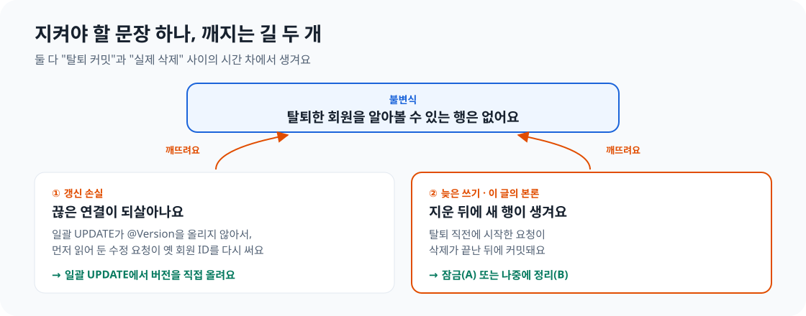
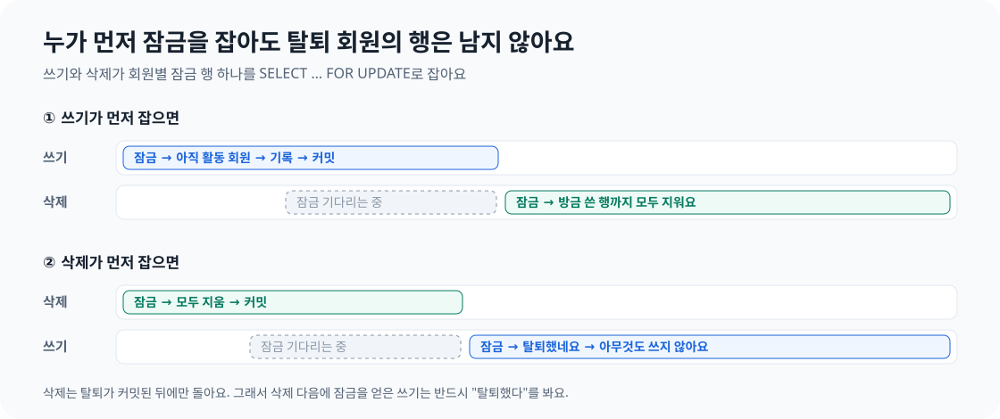
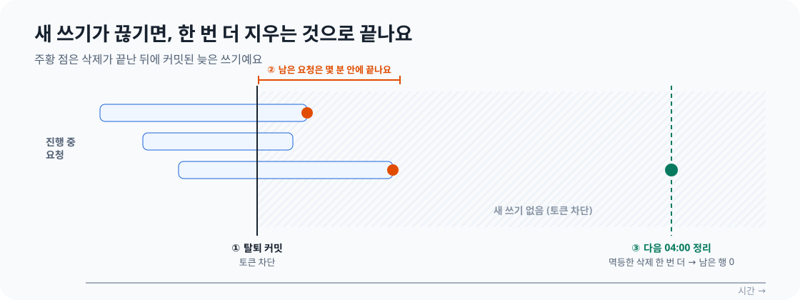

회원이 탈퇴했을 때, 꾸기의 두 영역은 같은 문제를 서로 다른 방식으로 해결해요. Growth는 잠금을 사용해서 탈퇴한 회원의 데이터가 잠깐이라도 다시 생기지 않게 막아요. Meal, Workout, Coaching은 잠금을 사용하지 않아요. 뒤늦게 생긴 데이터는 다음 정리 배치에서 지워요.

안녕하세요. 꾸기에서 Member 도메인을 맡고 있는 설문혁입니다. 이번 글에서는 같은 문제에 왜 두 가지 답을 선택했는지 이야기해 보려고 해요. 먼저 지켜야 할 규칙과 그 규칙이 깨지는 상황을 살펴보고, 검토했던 방법 가운데 실제로 선택한 두 가지의 비용과 선택 기준을 짚어볼게요.

결론부터 보면 이래요.

| | A. 잠금 (Growth) | B. 나중에 정리 (Meal · Workout · Coaching) |
| --- | --- | --- |
| 방식 | 삭제와 쓰기가 같은 잠금을 잡은 상태에서 확인하고 처리해요 | 늦게 생긴 행을 허용하고, 멱등한 삭제를 다시 실행해요 |
| 잘못된 상태 | 생기지 않아요 | 다음 정리 배치까지 남아요(최대 2일) |
| 비용 | 모든 쓰기 경로에서 잠금을 잡아야 해요 | 데이터가 잠시 일치하지 않는 구간과 배치 운영이 필요해요 |
| 선택한 이유 | 이미 잠금이 있었어요 | 쓰기 경로가 많았고, 어차피 재시도 수단이 필요했어요 |

한 가지 더 있어요. Growth에도 결국 B가 필요했어요. A와 B는 경쟁하는 방법이 아니에요. A는 막기, B는 복구를 맡아요.

## 1. 먼저, 지켜야 할 규칙

동시성을 이야기하기 전에 "삭제됐다"가 정확히 어떤 상태인지 정해야 해요. 그래야 경합이 실제로 규칙을 깨뜨렸는지 판단할 수 있어요.

Play 스토어에 앱을 게시하려면 사용자가 계정을 삭제할 수 있어야 해요. 꾸기에는 남겨두고 싶은 데이터도 있어요. 식사 사진과 모델의 예측, 회원이 수정한 결과를 묶은 데이터는 음식 인식 모델을 다시 학습시키는 데 가장 가치가 커요. 그래서 회원에게 속한 데이터는 모두 삭제하되, 사진 데이터 묶음만 회원 ID를 제거한 뒤 보관하기로 했어요. 행을 지우는 대신 사람과의 연결을 끊는 방식을 비식별화라고 해요.

여기서 하나의 불변식이 나와요. 불변식은 항상 지켜져야 하는 조건이에요.

> **회원이 탈퇴한 뒤에는 그 회원을 식별할 수 있는 행이 남아 있으면 안 돼요.**

이후의 모든 판단은 이 문장을 기준으로 해요. 일부는 데이터베이스에서도 지키도록 했어요. 사진 인식 데이터와 연결된 식사만 회원 ID 없이 남을 수 있게 CHECK 제약 조건을 뒀어요. 다만 데이터베이스는 회원의 탈퇴 여부를 알 수 없으니, 불변식 대부분은 코드에서 지켜야 해요.

## 2. 규칙이 깨지는 두 가지 경로

꾸기의 회원 탈퇴는 이벤트로 처리해요. 탈퇴 트랜잭션이 커밋되면 Member가 `MemberWithdrawn` 이벤트를 발행해요. 커밋 이후 각 도메인이 이벤트를 받아 새 트랜잭션에서 자기 데이터를 삭제해요. 도메인끼리 서로의 상태를 직접 바꾸지 않고 이벤트로 변경을 알리는 규칙이에요(ADR-0008). 덕분에 Member는 다른 도메인을 몰라도 되지만, **탈퇴 커밋과 실제 데이터 삭제 사이에는 시간차가 생겨요.** 불변식이 깨지는 두 경로 모두 이 시간차에서 시작해요.


*첫 번째 경로는 짧고 해결 방법도 간단해요. 이 글에서 주로 다룰 문제는 두 번째 경로예요.*

### 2-1. 갱신 손실로 끊어진 연결이 되살아나요

회원과의 연결은 회원 ID를 NULL로 바꾸는 한 줄짜리 일괄 UPDATE로 끊어요. 회원이 탈퇴하기 직전, 다른 기기에서 식사를 수정하려고 해당 데이터를 읽었다고 해볼게요. 그사이 일괄 UPDATE가 회원 ID를 비웠는데, 뒤이어 수정 요청이 저장돼요. Hibernate는 처음 읽어온 엔티티의 모든 컬럼을 쓰면서 예전 회원 ID까지 다시 저장해요. 끊었던 연결이 되살아나는 거예요.

보통은 낙관적 잠금이 이런 일을 막아요. JPA가 저장할 때 `@Version` 컬럼을 비교하거든요. 하지만 JPQL 일괄 UPDATE는 엔티티를 거치지 않고 데이터베이스를 직접 수정하며 `@Version`도 바꾸지 않아요. 그래서 수정 요청은 변경을 알아차리지 못해요. 해결 방법은 일괄 UPDATE에서 버전을 직접 올리는 거예요.

```java
@Query("update Meal m set m.memberId = null, m.version = m.version + 1"
        + " where m.memberId = :memberId and m.photoRecognitionId is not null")
int clearMemberIdOfPhotoMeals(@Param("memberId") long memberId);
```

이제 수정 요청은 버전 검사에서 실패해요. 핵심은 간단해요. 낙관적 잠금이 동작하려면 엔티티를 우회하는 쓰기까지 모두 버전을 올려야 해요.

### 2-2. 늦은 쓰기가 새 행을 만들어요

두 번째 경로는 더 까다로워요. 탈퇴가 커밋되는 순간 토큰을 차단하므로, 그 뒤에 시작한 요청은 서버에 도달하지 못해요. 문제는 **탈퇴 직전에 이미 시작한 요청**이에요. 다른 기기에서 회원이 탈퇴 직전 식사 사진을 올렸다고 해볼게요. 요청은 회원 확인을 통과했고, 사진 인식 서버의 응답을 몇 초 동안 기다려요. 그사이 탈퇴가 커밋되고 데이터 삭제도 끝나요. 이후 업로드가 커밋되면 탈퇴한 회원의 ID를 가진 새 행이 생겨요.


*요청 중간에 외부 호출이 있으면 이 시간차가 길어져요.*

## 3. "저장 직전에 한 번 더 확인"으로는 해결되지 않아요

가장 먼저 떠오르는 방법은 저장 직전에 탈퇴 여부를 다시 확인하는 거예요. 하지만 확인과 저장 사이에도 틈이 있어요. 확인할 때는 활동 중이던 회원이 저장할 때는 탈퇴한 상태일 수 있어요. 확인을 늘리면 틈은 줄어도 없어지지는 않아요.

조건을 확인한 뒤 행동하기 전까지 그 조건이 바뀔 수 있는 문제를 check-then-act, 또는 TOCTOU(time of check to time of use)라고 해요. 해결하려면 **실제로 쓰는 순간에도 조건이 유효하다는 보장**이 필요해요. 다시 확인하는 것만으로는 보장할 수 없어요.

## 4. 검토한 다섯 가지 방법

생각할 수 있는 방법을 펼쳐놓고 비교했어요. 그중 두 가지를 선택했어요.

| 방법 | 동작 | 판단 |
| --- | --- | --- |
| 한 번 더 확인 | 저장 직전에 탈퇴 여부를 조회해요 | 제외했어요. 확인과 저장 사이의 틈이 남아요 |
| 동기 삭제 | 탈퇴 트랜잭션 안에서 Member가 각 도메인의 삭제를 호출해요 | 제외했어요. 이벤트 규칙을 깨고 트랜잭션이 길어져요. 이미 실행 중인 요청은 삭제 뒤에도 쓸 수 있어요 |
| 회원 행의 공유 잠금 | 모든 도메인의 쓰기가 Member 회원 행에 `FOR SHARE` 잠금을 잡고, 탈퇴는 배타 잠금을 잡아요 | 제외했어요(검토할 수 있었던 방법이에요). 다른 도메인이 Member 테이블의 잠금에 의존하고, 회원 행 하나가 모든 쓰기의 병목이 돼요 |
| **A. 도메인 안에서 잠금** | 쓰기와 삭제가 회원별로 같은 잠금 행을 잡아요 | Growth에 선택했어요 |
| **B. 반복 가능한 정리** | 정리 기간에 멱등한 삭제를 다시 실행해요 | Meal, Workout, Coaching에 선택했어요 |

`ON DELETE CASCADE`가 걸린 외래 키도 선택지는 아니었어요. 탈퇴해도 회원 행은 삭제하지 않고 `DEACTIVATED` 상태로 남겨요. 도메인 사이에는 외래 키도 두지 않아요.

## 5. A: 확인과 쓰기를 같은 잠금 아래 두기

### 동작 방식

Growth에는 스트릭 판정을 한 번에 하나씩 적용하려고 만든 회원별 잠금 행이 이미 있었어요. 쓰기와 삭제가 모두 그 행을 `SELECT ... FOR UPDATE`로 잠그게 하고, 탈퇴 여부 확인도 잠금 안으로 옮겼어요.

```java
// 쓰기: 판정 결과를 반영하기 전에
private boolean lockActiveMember(Long memberId) {
    boolean locked = memberLockRepository.findForUpdateByMemberId(memberId).isPresent();
    if (memberStatus.isWithdrawn(memberId)) {
        eraseLocked(memberId); // 쓰지 않고, 방금 잡은 잠금 행까지 지운다
        return false;
    }
    // ...
}

// 삭제: MemberWithdrawn 이벤트를 받으면
public void erase(Long memberId) {
    memberLockRepository.findForUpdateByMemberId(memberId);
    eraseLocked(memberId);
}
```

어느 쪽이 먼저 잠금을 잡아도 안전해요. 쓰기가 먼저 잡으면 쓰고 커밋할 때까지 삭제가 기다려요. 이후 삭제가 방금 쓴 행까지 지워요. 삭제가 먼저 잡으면 삭제가 커밋될 때까지 쓰기가 기다려요. 이후 쓰기는 탈퇴 상태를 확인하고 아무것도 쓰지 않아요. 두 번째 경우에는 한 가지 전제가 있어요. 삭제는 탈퇴가 커밋된 뒤에만 실행돼요. 따라서 삭제 이후 잠금을 잡은 쓰기는 반드시 탈퇴 상태를 볼 수 있어요.


*두 조건이 모두 중요해요. 탈퇴 확인이 잠금 안에 있어야 하고, 쓰기와 삭제가 같은 행을 잠가야 해요.*

### A의 장점

- **잘못된 상태가 생기지 않아요.** 아주 짧은 구간도 없어요. 이런 상태를 강한 일관성이라고 해요.
- **결과를 결정적으로 테스트할 수 있어요.** 두 스레드의 실행 순서를 정해놓고 결과를 검증할 수 있어요.

### A의 비용

- **모든 쓰기 경로에서 잠금을 잡아야 해요.** 하나라도 빠지면 틈이 다시 생겨요. Growth는 판정을 적용할 때 이미 잠금을 잡고 있어서 변경 비용이 작았어요. 반면 Meal, Workout, Coaching에는 쓰기 트랜잭션이 합쳐서 20개가 넘고, 각각을 바꿔야 해요.
- **느린 작업 동안 잠금을 잡을 수 있어요.** 식사 사진 저장에는 몇 초 걸리는 인식 호출이 들어가요. A를 적용하려면 호출 중에도 잠금을 잡아 같은 회원의 다른 쓰기를 막거나, 마지막에 짧은 트랜잭션에서 확인과 쓰기를 처리하도록 저장 흐름을 바꿔야 해요.
- **잠금 순서와 교착 상태(deadlock)를 신경 써야 해요.** Coaching의 일일 목표처럼 다른 행도 잠그는 쓰기 경로에서는 잠금 순서를 일정하게 맞춰야 해요. 그렇지 않으면 두 트랜잭션이 서로를 계속 기다릴 수 있어요.
- **잠금 행을 만드는 과정에도 경합이 있어요.** 같은 회원의 첫 요청 두 개가 동시에 행을 만들려고 할 수 있어요. Growth는 별도의 짧은 트랜잭션에서 잠금 행을 만들어, 유일 제약 위반이 업무 트랜잭션까지 망가뜨리지 않게 처리해요.

### A가 맞는 상황

이미 잠금이 있고, 쓰기 경로가 적으며, 잘못된 상태가 잠깐도 보여서는 안 될 때예요.

## 6. B: 허용한 뒤 수렴시키기

### 동작 방식

각 도메인에는 삭제를 맡는 컴포넌트가 하나씩 있어요. Meal은 아래와 같아요.

```java
@Transactional(propagation = Propagation.REQUIRES_NEW)
public void forget(long memberId) {
    recognitionRepository.clearMemberId(memberId);          // 사진 인식: 연결만 끊기
    mealRepository.clearMemberIdOfPhotoMeals(memberId);     // 사진 식사: 연결만 끊기
    mealRepository.deleteItemsOfMealsWithoutPhoto(memberId);
    mealRepository.deleteMealsWithoutPhoto(memberId);       // 사진 없는 식사: 삭제
}
```

각 문장은 "이 회원 ID를 가진 행"을 대상으로 하는 일괄 작업이에요. 그래서 컴포넌트를 여러 번 실행해도 결과가 같은, 멱등한 삭제가 돼요. 이미 지운 행에는 아무 작업도 하지 않고, 늦게 생긴 행이 있으면 그 행만 처리해요.

이 컴포넌트는 두 곳에서 호출해요. 탈퇴 직후에는 이벤트 핸들러가 호출해요. 정리 배치는 최근 7일 안에 탈퇴한 회원을 대상으로 매일 한국 시간 04:00과 서버 시작 시 한 번씩 다시 호출해요.

### 잠금 없이도 수렴하는 이유

B에서 답해야 할 질문은 이거예요. 잠금이 없는데 정리가 언젠가는 끝난다고 어떻게 확신할 수 있을까요? **새로운 늦은 쓰기가 계속 들어오지 않기 때문**이에요.

1. 탈퇴가 커밋되면 회원의 토큰을 차단해요. 새로운 쓰기 요청은 시작할 수 없어요.
2. 따라서 늦은 쓰기는 탈퇴 전에 시작해서 아직 실행 중인 요청에서만 나와요. 요청 수는 유한하고, 몇 분 안에 끝나요.
3. 요청이 모두 끝난 뒤 멱등한 삭제를 한 번 더 실행하면 남은 데이터가 없어져요. 다음 04:00 배치가 그 한 번을 맡아요.


*쓰기가 계속 들어오거나 삭제가 멱등하지 않으면 B는 끝나지 않아요.*


*정리 기간은 Member의 쿼리 한 곳에서 정하므로 모든 도메인이 같은 값을 사용해요.*

### B의 장점

- **쓰기 코드를 건드리지 않아도 돼요.** 20개가 넘는 쓰기 경로를 바꿀 필요가 없었어요.
- **실패한 삭제도 다시 처리해요.** 이벤트 처리에 실패한 회원도 같은 배치가 재시도해요. 회원마다 별도 트랜잭션으로 실행하므로 한 명의 실패가 나머지를 막지 않아요.

### B의 비용

- **데이터가 잠시 일치하지 않는 구간이 있어요.** 늦게 생긴 행은 다음 배치까지 남고, 한 번 실행이 실패하면 최대 2일 동안 남을 수 있어요. 이 비용은 분명히 말할 수 있어야 해서 개인정보처리방침에도 적었어요.
- **운영이 필요해요.** 현재 정리 배치가 실패하면 오류 로그만 남아요. 7일 동안 계속 실패하는 회원을 누군가 알아차려야 해요. 서버가 여러 대라면 배치가 동시에 실행될 수도 있어요. 멱등해서 결과에는 문제가 없지만 작업이 중복되고 로그도 늘어요.
- **테이블을 빠뜨릴 수 있어요.** 회원 ID가 있는 새 테이블을 추가하면 정리 컴포넌트에도 넣어야 해요. 이를 강제하는 장치는 없어요.
- **부하를 살펴야 해요.** 일괄 삭제가 배치로 실행되므로 테이블이 커지면 주의가 필요해요.

### B가 맞는 상황

쓰기 경로가 많고, 잠깐 데이터가 일치하지 않아도 되며, 어차피 재시도 수단이 필요할 때예요.

## 7. 선택의 순간

각 도메인에 적용한 기준을 표로 정리하면 이래요.

| 질문 | Growth | Meal · Workout · Coaching |
| --- | --- | --- |
| 회원별 잠금이 이미 있나요? | 있어요 | 없어요 |
| 쓰기 경로는 몇 개인가요? | 적고, 이미 잠금을 잡아요 | 20개가 넘어요 |
| 쓰기 중 느린 외부 작업이 있나요? | 없어요 | 있어요. 사진 인식에 몇 초가 걸려요 |
| 잘못된 상태가 잠깐 보여도 되나요? | 되지만 잠금 비용이 거의 없어요 | 돼요 |
| **선택** | **A** | **B** |

Meal, Workout, Coaching에서 B를 고른 이유는 B가 언제나 더 나아서가 아니에요. 감수하고 설명할 수 있는 짧은 구간을 없애려고 모든 쓰기 경로를 바꾸고 느린 호출 동안 잠금을 잡는 비용이 컸기 때문이에요.

Growth는 잠금이 이미 있었어요. 탈퇴 확인을 그 안으로 옮기는 것만으로 비용을 거의 들이지 않고 틈을 닫을 수 있었어요.

### 그런데 Growth에도 B가 필요했어요

Growth에 A를 선택한 뒤에도 정리 배치를 추가했어요. 왜 그랬을까요? A는 다음 쓰기가 들어와 탈퇴 여부를 확인할 때 동작해요. 탈퇴 이벤트 핸들러 자체가 실패하고 그 회원의 판정이 더는 들어오지 않으면, 확인할 기회가 없어 행이 계속 남아요.

여기서 **A와 B가 서로 다른 문제를 푼다**는 점이 분명해졌어요. A는 잘못된 상태가 쓰이지 않도록 막아요. B는 늦은 쓰기든 삭제 실패든, 이미 생긴 잘못된 상태를 복구해요. 그래서 네 도메인 모두 B를 두고, Growth에는 A도 적용했어요.


*하나만 골라야 한다면 복구를 선택해야 해요. 막기만으로는 실패한 삭제를 다시 처리할 수 없어요.*

## 8. 비용을 개인정보처리방침의 문장으로 옮겼어요

B를 선택하면서 데이터가 남을 수 있는 구간도 받아들였어요. 이를 숨기지 않고 개인정보처리방침에 **"탈퇴 후 최대 2일 이내 처리"**라는 구체적인 약속으로 적었어요. 대부분은 탈퇴 직후 삭제돼요. 늦게 생긴 행은 다음 04:00 배치에서 사라지고, 그 배치가 실패하면 이후 실행에서 처리해요.

저는 이 부분이 가장 기억에 남아요. 법률 문서에서 삭제 정책이 먼저 내려온 게 아니었어요. 동시성을 다루며 정한 숫자가 회원에게 드리는 약속이 됐어요.

## 9. 일반화해 보면: 틈을 닫는 세 가지 도구

회원 탈퇴만의 문제는 아니에요. 한 시점에 조건을 확인하고 나중에 그 조건을 믿고 행동하는 곳마다 같은 형태가 나타나요. "이 회원에게 열린 코칭 계획이 없으니 하나 만들자", "재고가 있으니 주문을 받자", "캐시를 비웠으니 이제 최신이다" 같은 경우예요. 매번 실제로 쓰는 순간까지 조건이 유효하다는 보장이 필요해요. 여기에 쓸 수 있는 도구는 세 가지예요.

| 도구 | 틈을 닫는 방법 | 꾸기의 사례 |
| --- | --- | --- |
| 잠금 | 확인과 쓰기를 조건을 바꾸는 작업과 같은 순서로 처리해요 | Growth의 회원별 잠금 |
| 데이터베이스 제약 조건 | 쓰는 순간 데이터베이스가 원자적으로 최종 확인해요 | 회원당 열린 코칭 계획 하나, 회원당 하루 체중 기록 하나, 사진 식사의 CHECK 조건 |
| 반복 가능한 정리 | 틈을 허용하고 새 쓰기가 멈춘 뒤 멱등한 배치로 수렴시켜요 | 탈퇴 정리 배치 |

"한 번 더 확인"은 이 목록에 없어요.

다시 탈퇴 기능을 만든다면 저는 먼저 아래 질문을 할 거예요.

1. **불변식이 정확히 무엇인가요?** 어떤 행을 지워야 하고, 어떤 행은 사람과의 연결만 끊으면 되나요?
2. **모든 쓰기가 버전을 올리나요?** 엔티티를 우회하는 일괄 UPDATE는 낙관적 잠금을 조용히 무력화해요.
3. **확인과 쓰기 사이에 틈이 있나요?** 잠금, 제약 조건, 정리 배치 중 무엇으로 다룰 건가요? 한 번 더 확인하는 것만으로는 해결되지 않아요.
4. **정리를 선택했다면 새 쓰기가 끊기고, 삭제는 멱등한가요?**
5. **막는 장치가 있는 곳에도 복구 수단이 있나요?** 그 비용을 사용자에게 숫자로 설명할 수 있나요?

## 다음에 할 일

- **정리 배치 실패 알림.** 7일 내내 처리에 실패한 회원은 로그에만 남지 않고 담당자가 알 수 있어야 해요.
- **서버가 늘어날 때 잠금 다시 살펴보기.** Growth의 잠금은 데이터베이스에 있어서 계속 동작해요. 정리 배치에는 중복 실행을 피할 배치 단위 잠금이 필요할 수 있어요.
- **워치 데이터 정리.** 워치에 남아 아직 전송되지 않은 운동 기록도 탈퇴할 때 삭제해야 해요. 규칙은 정했고, 구현은 워치 동기화 작업에서 진행할 예정이에요.