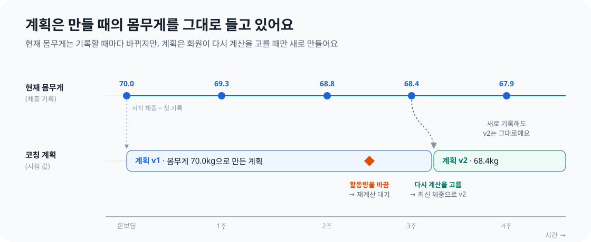

지난 [DDD를 어떻게 적용해야 할까?](/posts/ddd-domain-boundaries/) 글에서는 Coaching이 코칭 계획을 만드는 방식을 소개했어요. Coaching은 Member의 엔티티를 직접 참조하지 않아요. 대신 Member가 제공하는 프로필 값인 `MemberProfileSnapshot`을 받아 자체 모델인 `PlanInput`으로 변환해요. 그 값 중 하나가 `weightKg`였어요.

일주일 뒤, 그 필드는 사라졌어요. 이름이 `startWeightKg`으로 바뀌었고, Coaching은 이제 체중 기록이 하나도 없을 때 대신 쓰는 경우를 빼면, 이 값을 회원의 몸무게로 쓰지 않아요.

안녕하세요. 꾸기에서 Member 도메인을 맡고 있는 설문혁입니다. 앞선 DDD 글은 새로운 요구사항이 생기면 도메인 모델도 달라질 수 있다는 이야기로 끝났어요. 이번 글은 실제로 달라진 사례를 다뤄요. "이 화면에는 어떤 몸무게를 보여줘야 하지?"라는 작은 질문에서 시작해, 시간이 지나며 바뀌는 값에 적용할 규칙 하나를 정하게 됐어요. **계속 바뀌는 값은 그 이력을 기록하고 해석하는 영역이 책임져야 해요.**

## 1. 한 단어, 두 개념

### 몸무게가 두 곳에 있었어요

꾸기는 온보딩할 때 키, 몸무게, 활동 수준 같은 신체 정보를 받아요. 이 값은 회원 프로필에 저장되고, Coaching은 이를 이용해 하루 목표 칼로리를 계산해요.

이후 Coaching에 체중 기록 기능이 생겼어요. 회원이 날짜별로 몸무게를 기록할 수 있게 되면서 **몸무게가 두 곳에 존재하게 됐어요.** 프로필에도 몸무게가 있고, 체중 기록에도 몸무게가 있어요. 회원이 프로필 수정 화면에서 몸무게를 바꾸면 프로필만 바뀌고, 체중 기록 화면에서 입력하면 기록만 추가됐어요.

그렇다면 Coaching이 계획을 계산할 때는 어느 값을 읽어야 할까요? 마이페이지에는 무엇을 "현재 몸무게"로 보여줘야 할까요?


*왼쪽은 변경 전, 오른쪽은 현재 구조예요.*

### 중복보다 문제였던 건 한 단어가 두 개념을 가리킨다는 점이었어요

처음에는 같은 값을 두 곳에 저장한 중복 문제처럼 보였어요. 한쪽을 선택하고 다른 쪽을 지우면 될 것 같았죠. 그런데 자세히 보니 두 값은 같은 개념이 아니었어요.

프로필의 몸무게는 온보딩할 때 회원이 입력한 **속성**이에요. 한 시점에 입력한 값이죠. 반면 체중 기록은 매일 쌓이는 **측정 이력**이고, 변화 추이를 봐야 의미가 있어요. "몸무게"라는 한 단어로 두 개념을 부르고 있었던 거예요.

DDD에서는 도메인의 개념을 팀이 같은 말로 이해하고 사용하는 체계를 **유비쿼터스 언어**라고 해요. 한 단어가 두 뜻으로 쓰인다면 어느 값이 맞는지부터 고를 게 아니라, 개념마다 이름을 붙여야 해요. 그래서 "몸무게"를 두 용어로 나눠 용어집에 적었어요.

| 용어 | 의미 | 바뀌나요? | 책임 영역 |
| --- | --- | --- | --- |
| 시작 체중 | 온보딩할 때 입력한 몸무게 | 아니요. 온보딩 후에는 고정돼요 | Member |
| 현재 몸무게 | 체중 기록에서 가장 최근에 입력한 몸무게 | 네. 회원이 기록할 때마다 바뀌어요 | Coaching |

이름을 나누고 나니 혼란이 대부분 사라졌어요. 이제 물어야 할 것은 "어느 몸무게가 맞지?"가 아니라 "현재 몸무게는 누가 책임지지?"였어요.

## 2. 책임 영역 정하기

### 하나의 값에는 쓰는 곳도 하나

두 가지 방안을 검토했어요.

| 방안 | 동작 방식 | 장점 | 단점 |
| --- | --- | --- | --- |
| A. Member가 책임져요 | 프로필의 몸무게를 현재 값으로 보고, 체중을 기록할 때마다 프로필도 갱신해요 | 다른 도메인은 기존처럼 프로필을 읽으면 돼요 | 두 곳에서 같은 값을 변경해요 |
| B. Coaching이 책임져요 | 가장 최근 기록을 현재 몸무게로 사용하고, 프로필의 값은 "시작 체중"이 돼요 | 각 값을 변경하는 곳이 하나씩이에요 | 응답 필드명, 휴대폰 화면, 기존 데이터를 모두 바꿔야 해요 |

A를 구현하는 방법은 여러 가지예요. Coaching이 Member에 직접 쓸 수도 있지만, 도메인 간 상태 변경은 이벤트로 전달하고 다른 도메인은 조회만 할 수 있다는 팀 규칙(ADR-0008)에 어긋나요. 따라서 Coaching이 Member에 직접 쓸 수는 없어요. 대신 Member가 "체중 기록" 이벤트를 구독해 그 값을 프로필에 복사할 수는 있어요. 규칙에는 맞지만 핵심 문제는 남아요. 프로필 수정 화면과 체중 기록이 모두 "현재 몸무게"를 바꾸게 되니까요. 두 값이 다르면 어느 쪽을 따를지 결정해야 하고, 그 판단에는 결국 Coaching의 지식이 필요해요.

그러니까 A의 문제는 호출 방향이 아니라 **하나의 값을 바꾸는 곳이 두 군데라는 점**이었어요.

저희는 B를 선택했어요. 책임 영역을 정할 때는 세 가지를 물었어요.

1. **누가 값을 바꾸나요?** 회원이 체중을 기록할 때마다 바뀌어요. 기록은 Coaching에서 관리해요.
2. **누가 값을 해석하나요?** 변화 추이를 읽고 계획을 조정하는 일은 Coaching의 책임이에요.
3. **다른 곳에서도 필요한가요? 조회만 하면 되나요?** Member의 마이페이지는 값을 보여주기만 하므로 조회로 충분해요.

세 질문의 답이 모두 같은 영역을 가리킨다면 그곳이 값을 책임지고, 다른 곳은 읽어서 사용해요.

## 3. 현재 값과 결정을 내릴 때 사용한 값

이번 변경을 통해 한 가지 차이도 더 분명해졌어요.

코칭 계획은 "하루 목표는 1,850kcal"처럼 내린 결정이에요. 계획을 세울 때는 당시의 키, 몸무게, 활동 수준을 사용했어요. Coaching은 이 입력값을 계획 안에 **시점 값**으로 보관해요. 회원이 내일 새 몸무게를 기록해도, 계획을 세울 때 사용한 값은 그대로 남아요.

그래서 두 종류의 몸무게를 의도적으로 함께 보관하고, 용도에 맞게 사용해요.

- **현재 몸무게**는 "회원의 몸무게가 지금 얼마인가?"에 답해요. 화면에서는 최신 값을 조회해요.
- **계획 안의 몸무게**는 "이 결정을 내릴 때 어떤 값을 사용했나?"에 답해요. 계획을 만들 때 복사하고 이후에는 바꾸지 않아요.


*계획에는 만들 때 사용한 값이 남아요. 회원이 재계산을 선택할 때만 새 버전을 만들어요.*

계획이 현재 몸무게를 그대로 참조한다면, 회원이 체중을 기록할 때마다 하루 목표가 조용히 달라져요. 그러면 지난 일일 목표도 당시 평가 기준으로 삼았던 숫자와 맞지 않게 돼요. 앞선 DDD 글에서 소개한 `DailyGoal`도 같은 이유로 생성할 때 정한 목표 칼로리를 유지해요.

그럼 계획은 언제 새 값을 반영할까요? 회원 프로필이 바뀌면 Coaching이 `MemberProfileChanged` 이벤트를 받고, 진행 중인 계획을 "재계산 대기" 상태로 표시해요. 홈 화면에서 회원에게 재계산할지 묻고, 동의하면 Coaching이 현재 버전을 닫은 뒤 최신 프로필과 최근 체중으로 새 버전을 만들어요. 체중 변화 추이를 바탕으로 계획을 자동 조정하는 기능은 이후 출시를 계획하고 있어요.

## 4. 값이 잘못 보이지 않도록 책임 옮기기

B를 선택하면서 API와 휴대폰 앱, 기존 데이터를 바꿔야 했어요. 옮기는 동안 회원에게 잘못된 값이 보이지 않도록 다음과 같이 처리했어요.

### 시작 체중을 첫 기록으로 만들어요

온보딩이 끝나면 Member가 `MemberOnboarded` 이벤트를 발행해요. Coaching은 이 이벤트를 받아 시작 체중을 해당 날짜의 첫 체중 기록으로 저장해요. 핸들러는 온보딩 트랜잭션이 커밋된 뒤 별도 트랜잭션에서 실행돼요. 같은 이벤트를 두 번 받아도 기록은 하나만 남아요. 회원이 그날 이미 체중을 기록했다면 덮어쓰지 않아요.

기록의 출처도 새로 추가했어요. 회원이 직접 입력한 기록의 출처는 `MANUAL`이에요. 온보딩 체중도 회원이 입력한 값이니 `MANUAL`을 쓸 수 있었어요. 하지만 별도의 `ONBOARDING`을 두면 나중에 자동으로 생성한 기록을 찾아 수정할 수 있어요. 출처는 API 응답에 노출하지 않아서 외부에서 보이는 동작은 달라지지 않아요.

### 값이 없을 때의 처리는 조회 경로 한 곳에 두었어요

현재 몸무게는 가장 최근 기록이에요. 기록이 하나도 없다면 시작 체중을 사용해요. 이 규칙을 `LatestWeightService` 한 곳에 두고, 최근 체중 API와 계획 계산이 모두 이 서비스를 호출하도록 했어요.

```java
/** 프로필을 이미 읽은 호출자용. 가장 최근 기록, 없으면 {@code startWeightKg}. */
public LatestWeight resolve(long memberId, BigDecimal startWeightKg) {
    return repository
            .findFirstByMemberIdOrderByRecordedOnDesc(memberId)
            .map(record -> new LatestWeight(record.getWeight().getValue(), record.getRecordedOn()))
            .orElseGet(() -> new LatestWeight(startWeightKg, null));
}
```

이렇게 두니 한 가지 효과가 더 있었어요. 첫 기록은 이벤트 핸들러가 비동기로 만들기 때문에 생성에 실패할 수 있어요. 그래도 조회할 때 시작 체중을 사용하면 첫 기록에 들어갔을 값과 같아요. **어느 경우든 회원에게는 같은 숫자가 보여요.** 비동기 작업이 실패하더라도 조회 경로에서 값을 보완하면 회원이 보는 값에는 차이가 없어요.

### 여러 번 실행해도 결과가 같은 마이그레이션으로 과거 데이터를 채웠어요

변경 전에 온보딩한 회원에게는 첫 기록이 없어요. 데이터 마이그레이션에서 온보딩 날짜와 프로필의 몸무게를 이용해 기록을 채웠어요. 기록이 아예 없는 회원에게만 삽입하므로(`NOT EXISTS`), 다시 실행해도 행이 늘어나지 않아요. 이런 성질을 **멱등**, 즉 여러 번 실행해도 결과가 같은 성질이라고 해요.

```sql
INSERT INTO weight_record (member_id, recorded_on, weight_kg, source)
SELECT m.id, DATE(m.onboarded_at), p.weight_kg, 'ONBOARDING'
FROM member m
JOIN member_profile p ON p.member_id = m.id
WHERE m.onboarded_at IS NOT NULL
  AND NOT EXISTS (SELECT 1 FROM weight_record w WHERE w.member_id = m.id);
```

### 계약 변경을 한 번에 반영했어요

응답 필드명을 `weightKg`에서 `startWeightKg`으로 바꾸고, 프로필 수정 요청에서는 몸무게를 제거했어요. 백엔드와 휴대폰 앱을 따로 병합하면 그사이에 메인 브랜치의 앱과 서버가 서로 맞지 않게 돼요. 그래서 백엔드, API 계약, 휴대폰 앱 변경을 하나의 MR(merge request)에 담았어요. 이후에는 프로필 수정 화면에서도 시작 체중을 완전히 제거했어요. 바꿀 수 없는 값이라 수정 화면에 보여줄 이유가 없었어요.

## 마무리

이번 변경에서 얻은 규칙을 정리하면 다음과 같아요.

1. **같은 단어가 두 영역에서 쓰인다면 정말 같은 개념인지 확인해요.** 다르다면 다른 결정을 내리기 전에 개념마다 이름을 붙여요.
2. **하나의 값은 한 곳에서 바꿔요.** 값을 바꾸고 해석하는 영역이 책임지고, 다른 곳은 읽어서 사용해요.
3. **결정을 내릴 때 사용한 값은 복사해 보관해요.** 화면은 현재 값을 읽고, 계획은 만들 때 사용한 값을 유지해요.
4. **값이 없을 때의 처리는 조회 경로 한 곳에 둬요.** 그러면 비동기 작업에 실패해도 화면에는 같은 값이 보여요.
5. **계약 변경은 함께 반영해요.** 백엔드, 계약, 클라이언트를 한 번에 병합해 메인 브랜치가 중간에 깨지지 않도록 해요.

앞선 DDD 글에서 경계를 그었다고 모델링이 끝나는 것은 아니며, 각 규칙이 어디에 속하는지 계속 살펴보겠다고 썼어요. 몸무게는 코드가 이미 동작하는 상태에서 경계를 옮기게 만든 첫 번째 값이었어요. 앞으로도 이런 변경은 또 생길 거예요.

## 다음에 할 일

- **Health Connect에서 가져오는 기록.** Health Connect에서 받은 체중 기록과 수동으로 입력한 기록의 날짜가 같다면 어느 값을 사용할지 정해야 해요.
- **체중 변화 추이에 따른 계획 조정.** 지금은 회원이 재계산을 선택할 때만 계획이 바뀌어요. 변화 추이를 이용해 계획을 조정하는 기능은 이후 출시를 계획하고 있어요.