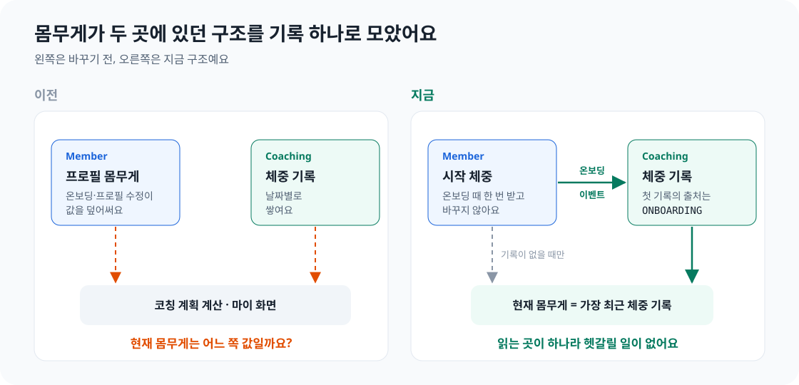
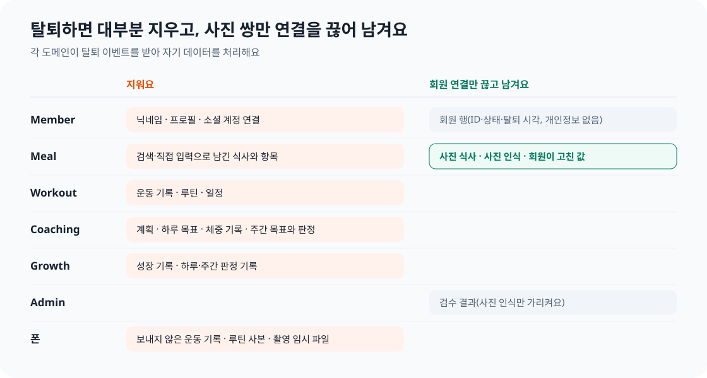
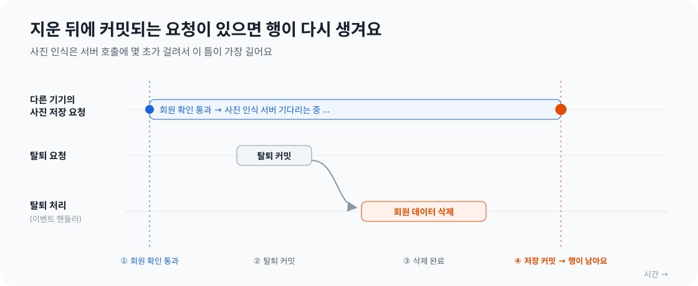
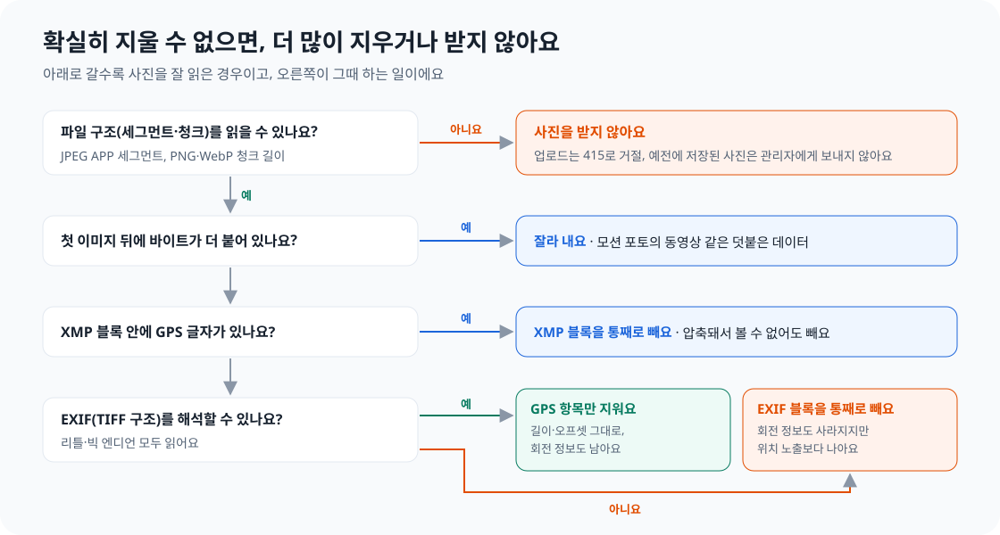

개발하다 보면 "이건 A로 할까, B로 할까"를 정해야 하는 순간이 생각보다 자주 와요. 대부분은 금방 지나가지만, 몇 개는 며칠이 지나도 머릿속에 남아 있어요. 고르지 않은 쪽이 틀린 답이 아니었기 때문이에요.

안녕하세요. 꾸기에서 회원(Member) 도메인을 맡고 있는 설문혁입니다. 이번 주에는 회원 탈퇴와 Play 스토어 출시 준비를 주로 했어요. 그 과정에서 내린 결정 가운데 오래 고민한 네 가지를 골라, **무엇을 골랐는지와 무엇을 고르지 않았는지**를 함께 정리해 보려고 해요.

먼저 결론부터 표로 보여 드릴게요.

| 질문 | 고른 길 | 고르지 않은 길 | 한 줄 이유 |
| --- | --- | --- | --- |
| 현재 몸무게는 누가 가지나요? | Coaching의 체중 기록 | Member 프로필의 몸무게 | 날마다 바뀌는 값은 기록을 쌓는 쪽이 가져야 해요 |
| 탈퇴하면 데이터를 어떻게 하나요? | 대부분 지우고, 사진 쌍만 연결을 끊어 남기기 | 모두 지우기, 또는 연결된 채로 모두 남기기 | 삭제 요건을 지키면서 모델 학습 데이터는 지켜요 |
| 삭제 뒤에 늦게 들어오는 쓰기는요? | 막을 수 있는 곳만 막고, 나머지는 매일 다시 치우기 | 모든 쓰기 경로에서 탈퇴 여부 확인하기 | 확인과 저장 사이의 틈은 확인을 더해도 남아요 |
| 사진 속 위치(GPS)는요? | 직접 지우고, 확실하지 않으면 받지 않기 | 위치가 저장된다고 알리기만 하기 | "위치를 저장하지 않아요"라고 약속하고 싶었어요 |

## 1. 몸무게는 누구의 것인가요?

### 같은 값이 두 곳에 있었어요

꾸기는 온보딩 때 키, 몸무게, 활동량 같은 신체 정보를 받아요. 이 값은 회원 프로필에 저장되고, 코칭(Coaching) 도메인이 이 값으로 하루 목표 칼로리를 계산해요.

그런데 Coaching에 "체중 기록" 기능이 들어오면서 문제가 생겼어요. 회원이 날짜별로 몸무게를 기록할 수 있게 되자, **몸무게가 두 곳에 생긴 거예요.** 프로필에도 몸무게가 있고, 체중 기록에도 몸무게가 있어요. 프로필 수정 화면에서 몸무게를 바꾸면 프로필 값만 바뀌고, 체중 기록 화면에서 기록하면 기록만 늘어났어요.

그러면 코칭 계획을 계산할 때나 마이 화면에 "현재 몸무게"를 보여 줄 때는 어느 값을 읽어야 할까요?


*왼쪽은 바꾸기 전, 오른쪽은 지금 구조예요.*

### 두 가지 안을 놓고 비교했어요

| 안 | 내용 | 좋은 점 | 아쉬운 점 |
| --- | --- | --- | --- |
| A. Member가 가진다 | 프로필 몸무게를 현재 값으로 보고, 체중을 기록할 때마다 프로필도 고친다 | 다른 도메인은 지금처럼 프로필만 읽으면 돼요 | Coaching의 기록이 Member의 값을 고쳐야 해서 도메인 사이에 쓰기가 생겨요 |
| B. Coaching이 가진다 | 현재 몸무게는 가장 최근 체중 기록이다. 프로필 몸무게는 "시작 체중"으로 의미를 바꾼다 | 바뀌는 값의 주인이 하나예요 | 응답 필드 이름, 폰 화면, 기존 데이터를 함께 바꿔야 해요 |

팀은 B를 골랐어요. 몸무게는 한 번 정하면 끝나는 정보가 아니라 시간에 따라 쌓이는 **기록**이에요. 기록을 쌓고 그 추세를 해석하는 쪽은 Coaching이에요. 꾸기는 도메인끼리 상태를 바꿀 때 이벤트로 알리고, 다른 도메인에는 조회만 하도록 규칙을 정해 두었어요. A를 고르면 체중을 기록할 때마다 Coaching이 Member의 값을 고쳐야 해서 이 규칙과도 맞지 않았어요.

### 바꾸면서 고민한 것들

**시작 체중을 첫 기록으로 남겼어요.** 온보딩이 끝나면 Member가 `MemberOnboarded` 이벤트를 내고, Coaching이 이 이벤트를 받아 시작 체중을 그날의 첫 체중 기록으로 저장해요. 이벤트를 두 번 받아도 기록이 하나만 남도록 만들었고, 회원이 그날 이미 기록한 값이 있으면 덮어쓰지 않아요.

**기록의 출처를 하나 더 만들었어요.** 회원이 직접 입력한 기록의 출처는 `MANUAL`이에요. 온보딩 때 자동으로 만든 기록도 결국 회원이 입력한 값이니 `MANUAL`로 둘 수도 있었어요. 하지만 출처를 `ONBOARDING`으로 나눠 두면 나중에 자동으로 만든 기록만 골라서 고칠 수 있어요. 이 출처는 API 응답에 나가지 않아서 바깥에서 보이는 모양은 그대로예요.

**기록이 없을 때의 규칙은 한 곳에만 두었어요.** 현재 몸무게는 가장 최근 기록이고, 기록이 하나도 없으면 시작 체중이에요. 이 규칙을 `LatestWeightService` 한 곳에 두고, 최신 체중 API와 코칭 계획 계산이 모두 이 서비스를 불러요.

```java
/** 가장 최근 기록, 없으면 startWeightKg. */
public LatestWeight resolve(long memberId, BigDecimal startWeightKg) {
    return repository
            .findFirstByMemberIdOrderByRecordedOnDesc(memberId)
            .map(record -> new LatestWeight(record.getWeight().getValue(), record.getRecordedOn()))
            .orElseGet(() -> new LatestWeight(startWeightKg, null));
}
```

**백엔드, 계약, 폰을 한 번에 바꿨어요.** 응답 필드 `weightKg`를 `startWeightKg`로 바꾸고 프로필 수정 요청에서 몸무게를 뺐어요. 이 변경을 백엔드와 폰으로 나눠 병합하면, 그 사이에 main 브랜치의 앱이 서버와 맞지 않게 돼요. 그래서 셋을 한 MR(Merge Request)에 묶었어요.

## 2. 탈퇴하면 데이터를 지울까요, 남길까요?

### 처음 결정을 다시 열었어요

Play 스토어에 앱을 올리려면 앱 안에서 계정을 삭제할 수 있어야 하고, 앱 밖에서도 삭제를 요청할 수 있는 웹 페이지가 있어야 해요. 그래서 회원 탈퇴를 만들면서 "탈퇴하면 무엇을 지우는가"를 정해야 했어요.

여기에는 이미 정해 둔 답이 하나 있었어요. 식사 사진, 사진을 보고 모델이 예측한 결과, 회원이 그 예측을 고친 값은 **탈퇴해도 영구 보관한다**는 결정이었어요. 이 세 가지는 꾸기의 음식 인식 모델을 다시 학습시키는 데 쓰는 가장 귀한 데이터예요. 모델이 틀렸고 사람이 어떻게 고쳤는지가 함께 남아 있기 때문이에요.

그런데 이 결정을 다시 보니 걸리는 점이 있었어요. 회원과 연결된 사진을 기간 없이 보관하는 것은 Play의 계정 삭제 정책과 개인정보보호법에 맞지 않을 수 있었어요. 그래서 선택지를 다시 놓고 비교했어요.

| 안 | 내용 | 좋은 점 | 아쉬운 점 |
| --- | --- | --- | --- |
| 연결된 채로 영구 보관 | 처음 결정 | 학습 데이터를 모두 지켜요 | 누구의 사진인지 알 수 있는 채로 남아요 |
| 모두 삭제 | 회원 데이터를 남김없이 지운다 | 가장 단순하고 분명해요 | 모델 학습과 관리자 검수에 쓰던 사진 쌍도 사라져요 |
| **연결만 끊고 보관** | 사진 쌍은 회원 ID만 지워 남기고, 나머지는 지운다 | 삭제 요건과 학습 데이터를 함께 지켜요 | DB 제약과 동시성 처리가 복잡해져요 |

세 번째 안을 골랐어요. 사진 쌍은 회원과의 연결을 끊어 누구의 것인지 알 수 없게 만든 뒤(비식별화) 남기고, 그 밖의 회원 데이터는 모두 지워요. 이 내용은 개인정보처리방침과 계정 삭제 안내 페이지에도 그대로 적었어요.


*각 도메인이 `MemberWithdrawn` 이벤트를 받아 자기 데이터를 처리해요. Member는 다른 도메인의 삭제를 직접 부르지 않아요.*

### 회원 ID가 비어도 되는 행이 생겼어요

이 결정에는 대가가 있었어요. 식사 테이블의 `member_id`는 원래 비어 있으면 안 되는 칸(NOT NULL)이었어요. 사진 식사의 연결을 끊으려면 이 제약을 풀어야 해요.

하지만 그냥 풀면 사진이 없는 식사도 회원 ID 없이 남을 수 있어요. 그런 행은 누구의 것도 아니고, 쓸모도 없는 데이터예요. 그래서 제약을 푸는 대신 **"회원 ID가 없으면 사진 인식과는 반드시 연결되어 있어야 한다"**는 조건을 DB에 걸었어요.

```sql
ALTER TABLE meal
    ADD CONSTRAINT ck_meal_member_id_or_photo
    CHECK (member_id IS NOT NULL OR photo_recognition_id IS NOT NULL);
```

### 연결을 끊는 UPDATE에서 버전을 올렸어요

구현하면서 가장 오래 본 코드는 회원 ID를 지우는 한 줄짜리 UPDATE였어요.

```java
@Modifying(flushAutomatically = true, clearAutomatically = true)
@Query("update Meal m set m.memberId = null, m.version = m.version + 1"
        + " where m.memberId = :memberId and m.photoRecognitionId is not null")
int clearMemberIdOfPhotoMeals(@Param("memberId") long memberId);
```

`m.version = m.version + 1`이 없으면 이런 일이 생길 수 있어요. 탈퇴 직전에 다른 기기에서 식사를 고치는 요청이 식사를 먼저 읽어 두었다고 해 볼게요. 그 사이 탈퇴 처리가 회원 ID를 지워요. 그 뒤 수정 요청이 저장하면, Hibernate가 처음 읽은 회원 ID를 그대로 다시 써서 **지운 연결이 되살아나요.**

버전을 올려 두면 이 수정 요청은 낙관적 잠금(버전이 바뀌었으면 저장을 실패시키는 방식)에 걸려 실패해요. 연결은 끊긴 채로 남아요.

## 3. 늦게 들어오는 쓰기는 막을까요, 받아들일까요?

### 지운 뒤에 다시 생기는 행

탈퇴 처리는 이벤트로 돌아요. 탈퇴가 커밋되면 각 도메인이 이벤트를 받아 자기 데이터를 지워요. 탈퇴한 회원의 토큰은 바로 막아서, 탈퇴 뒤에 시작한 요청은 서버에 닿지 않아요.

문제는 **탈퇴 직전에 시작한 요청**이에요. 다른 기기에서 탈퇴 직전에 사진을 올렸다고 해 볼게요. 그 요청은 회원 확인을 이미 통과했고, 사진 인식 서버의 응답을 몇 초 동안 기다려요. 그 사이 탈퇴가 커밋되고 삭제가 끝나요. 그다음에 사진 저장 요청이 커밋되면, **탈퇴한 회원 ID가 붙은 행이 새로 생겨요.**


*저장 요청이 시작될 때는 아직 탈퇴 전이라 확인을 통과해요.*

### 확인을 더 넣어도 틈은 남아요

처음 떠오른 방법은 쓰기 직전에 탈퇴 여부를 한 번 더 확인하는 것이었어요. 하지만 확인과 저장 사이에도 틈이 있어요. 확인한 순간에는 탈퇴 전이었는데 저장하는 순간에는 탈퇴 후일 수 있어요. 확인을 몇 번 더 넣어도 틈은 작아질 뿐 사라지지 않아요.

이 틈을 완전히 닫으려면 확인과 저장이 같은 잠금 안에 있어야 해요. 그런데 꾸기의 도메인 가운데 회원별 잠금을 이미 가진 곳은 성장(Growth) 하나뿐이었어요. 그래서 도메인마다 다르게 답했어요.

| 도메인 | 방법 | 이유 |
| --- | --- | --- |
| Growth | 회원별 잠금을 잡은 직후 탈퇴 여부를 확인해요 | 이미 회원별 잠금이 있어서, 잠금 안에서 확인하면 틈이 없어요 |
| Meal · Workout · Coaching | 알려진 한계로 기록하고, 매일 정리 배치로 치워요 | 잠금을 새로 만들면 모든 쓰기 경로가 바뀌고, 그래도 사후 정리는 필요해요 |

Growth는 판정 결과를 반영할 때마다 회원별 잠금 행을 먼저 잡아요. 잠금을 잡은 직후 탈퇴 여부를 보고, 탈퇴한 회원이면 쓰지 않고 그 회원의 Growth 데이터를 지워요.

```java
private boolean lockActiveMember(Long memberId) {
    boolean locked = memberLockRepository.findForUpdateByMemberId(memberId).isPresent();
    if (memberStatus.isWithdrawn(memberId)) {
        eraseLocked(memberId); // 쓰지 않고, 방금 잡은 잠금 행까지 지운다
        return false;
    }
    // ...
}
```

### 나머지는 매일 다시 치워요

Meal, Workout, Coaching은 정리 배치로 처리했어요. 매일 한국 시간 04:00과 서버가 시작될 때, **최근 7일 안에 탈퇴한 회원**의 데이터를 다시 정리해요.

```java
@Scheduled(cron = "0 0 4 * * *", zone = "Asia/Seoul")
public void daily() { run(); }

@EventListener(ApplicationReadyEvent.class)
public void onStartup() { run(); }
```


*정리 창 길이는 Member의 조회 한 곳에만 두어서 네 도메인이 같은 값을 써요.*

이 설계에는 몇 가지 판단이 들어 있어요.

- **정리 창은 짧아도 돼요.** 늦은 쓰기는 탈퇴 직전에 시작한 요청이 끝날 때까지만 생겨요. 길어야 몇 분이에요. 7일은 넉넉한 여유예요.
- **같은 회원을 여러 번 정리해도 괜찮아요.** 정리 부품은 모두 "이 회원 ID의 행을 지워라" 같은 일괄 문장이에요. 이미 지웠으면 대상이 없어서 결과가 같아요. 그래서 이벤트 처리가 실패한 회원도 창이 끝날 때까지 매일 다시 시도돼요.
- **회원 하나가 실패해도 다음 회원을 계속 처리해요.** 회원마다 트랜잭션을 따로 열어서, 실패한 회원만 되돌리고 오류 로그를 남겨요.
- **분산 잠금은 두지 않았어요.** 지금 서버는 한 대이고, 두 번 돌아도 결과가 같아요. 서버를 늘릴 때 다시 정해요.

덕분에 개인정보처리방침에 **"탈퇴 후 최대 2일 안에 처리해요"**라고 적을 수 있었어요. 보통은 다음 날 04:00에 끝나고, 그 실행이 실패해도 그다음 날 실행이 처리하기 때문이에요.

## 4. 사진 속 위치는 어떻게 지울까요?

### 휴대폰 사진에는 위치가 들어 있어요

휴대폰으로 찍은 사진에는 보통 촬영 위치(GPS)가 들어 있어요. 사진 파일 안의 EXIF라는 메타데이터 영역에 위도와 경도가 적혀 있고, 어떤 사진은 XMP라는 다른 영역에도 위치를 적어요. 식사 사진은 집에서 찍는 경우가 많아서, 위치가 남으면 회원의 집 주소가 드러날 수 있어요.

이 문제는 관리자 검수 화면을 만들 때 처음 다뤘어요. 관리자는 회원이 고친 사진 쌍을 보고 학습에 써도 되는지 판단하는데, 이때 사진에 위치가 남아 있으면 안 됐어요. 그래서 처음에는 **관리자에게 사진을 보여 줄 때** GPS를 지웠어요.

그런데 개인정보처리방침을 쓰면서 다시 보니, 원본 사진에는 여전히 위치가 저장되어 있었어요. 방침에 "원본 사진에 위치가 함께 저장돼요"라고 알리는 방법도 있었지만, **"위치를 저장하지 않아요"**라고 약속하는 쪽을 골랐어요. 그래서 GPS를 지우는 위치를 맨 앞으로 옮겼어요.


*사진 객체를 만드는 `MealPhoto.of`가 사진이 서버에 들어오는 유일한 길이라서, 여기서 지우면 빠뜨리는 경로가 없어요.*

### 다시 그리지 않고, 위치만 지웠어요

사진에서 GPS를 지우는 가장 쉬운 방법은 이미지 라이브러리로 사진을 읽어 다시 저장하는 것이에요. 메타데이터가 모두 빠지니까요. 하지만 다시 인코딩하면 화질이 바뀌고, 사진 방향(회전) 정보까지 사라져서 사진이 옆으로 누워 보일 수 있어요.

그래서 사진 파일의 구조를 직접 읽어서 **GPS 항목만 지웠어요.** JPEG의 APP1 세그먼트, PNG의 `eXIf` 청크, WebP의 `EXIF` 청크에서 EXIF를 찾고, 그 안에서 GPS 정보를 가리키는 항목을 빼고 GPS 값이 있던 바이트를 0으로 덮어요. 파일 길이와 다른 위치 정보는 그대로라서 나머지 태그는 손대지 않아요. PNG는 청크마다 체크섬(CRC)이 있어서 JDK의 `CRC32`로 다시 계산했어요. 새 라이브러리는 쓰지 않았어요.

### 확실하지 않으면 받지 않아요

여기서 가장 중요하게 정한 원칙은 **fail-closed**예요. 확실하게 지웠다고 말할 수 없으면, 더 많이 지우거나 아예 받지 않아요.


*EXIF를 통째로 빼면 회전 정보도 사라져요. 그래도 위치가 노출되는 것보다는 낫다고 판단했어요.*

코드에서는 사진 객체를 만드는 순간 이 판단이 끝나요. 구조를 읽을 수 없는 사진은 GPS가 없다고 확인할 수 없으니 415로 거절해요.

```java
public static MealPhoto of(byte[] content) {
    // 빈 파일 → 10MB 초과 → 형식(JPEG·PNG·WebP) 순서로 먼저 거른다
    // ...
    try {
        return new MealPhoto(format, PhotoGpsRemover.remove(content, format));
    } catch (PhotoGpsRemover.BrokenPhotoException e) {
        throw new BusinessException(ErrorCode.UNSUPPORTED_MEDIA_TYPE, "사진 파일을 읽을 수 없다");
    }
}
```

리뷰에서는 우리가 놓친 경로가 더 나왔어요. 압축된 PNG XMP 청크, PNG의 `Raw profile type` 텍스트 청크, JPEG의 확장 XMP(ExtendedXMP), 모션 포토처럼 첫 이미지 뒤에 동영상이 붙은 파일이었어요. 위치가 숨을 수 있는 곳은 생각보다 많았어요. 모두 같은 원칙으로 막았어요. 읽을 수 없거나 확신할 수 없으면 블록째 빼요.

관리자 조회 때 지우는 코드는 남겨 두었어요. 이 변경 전에 저장된 사진에는 위치가 있을 수 있기 때문이에요. 이미 지운 사진을 한 번 더 지워도 결과가 같아서 새 사진에는 해가 없어요.

## 정리하며

네 가지 결정을 돌아보면 공통점이 하나 있었어요.

1. **바뀌는 값에는 주인이 하나여야 해요.** 몸무게가 두 곳에 있을 때는 어느 쪽이 맞는지부터 따져야 했어요. 주인을 Coaching 하나로 정하자 읽는 쪽의 고민이 없어졌어요.
2. **이미 정한 결정도 다시 열 수 있어요.** "영구 보관"은 이미 합의한 결정이었지만, 출시 요건과 법을 다시 읽고 바꿨어요. 결정을 바꾼 날짜와 이유를 요구사항 문서에 함께 남겼어요.
3. **모든 틈을 막을 수 없다면, 막을 수 있는 곳과 치울 수 있는 곳을 나눠요.** 늦은 쓰기를 모든 곳에서 막으려고 했다면 코드가 훨씬 복잡해졌을 거예요. Growth만 막고 나머지는 사후 정리로 처리해서 "최대 2일"이라는 약속을 지킬 수 있었어요.
4. **확실하지 않으면 안전한 쪽으로 실패해요.** GPS를 지우지 못했다고 사진을 그대로 저장하면 약속이 깨져요. 그런 사진은 받지 않는 쪽이 회원에게 더 정직해요.

고르지 않은 길도 틀린 답은 아니었어요. 모두 삭제하는 쪽이 더 단순했고, 확인을 더하는 쪽이 더 직관적이었어요. 다만 꾸기가 회원에게 하려는 약속과 지금 팀이 감당할 수 있는 복잡도를 함께 놓고 보았을 때, 고른 쪽이 조금 더 맞았어요.

## 다음에 할 일

- **정리 배치에 경보를 붙이려고 해요.** 지금은 정리에 실패하면 오류 로그만 남겨요. 7일 동안 계속 실패하는 회원이 있으면 사람이 알 수 있어야 해요.
- **서버를 두 대 이상으로 늘리면 분산 잠금을 다시 정해요.** 지금은 한 대라서 잠금 없이도 괜찮아요.
- **워치에 남은 기록도 정리해야 해요.** 탈퇴하면 워치에 남은 미전송 운동 기록도 지워야 한다는 규칙만 정해 두었고, 구현은 워치 동기화 작업으로 넘겼어요.
