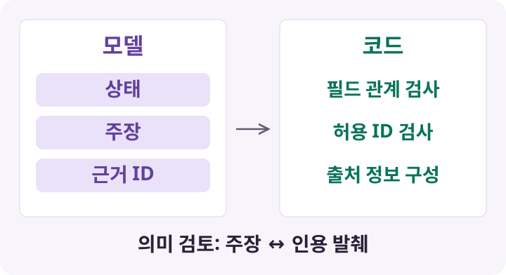
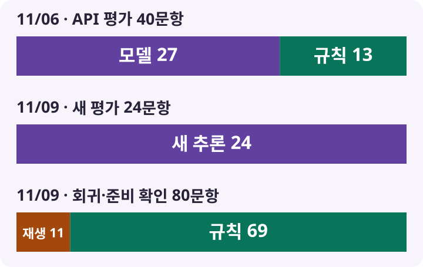
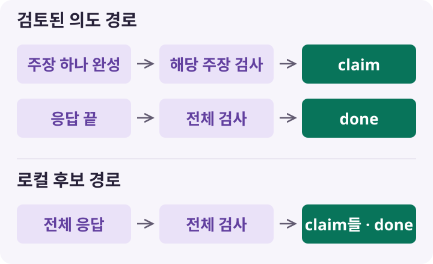

[첫 편](/posts/rag-retrieval-model-selection)에서는 영양표 질문에 필요한 근거를 찾는 검색 방식을 골랐어요. 다음 선택은 그 근거를 읽고 답할 생성 모델이었어요.

우리가 처음 고정한 모델은 `gpt-5.4-mini-2026-03-17`이었어요. 이 모델에 질문과 검색 근거를 주고, 답변 내용과 함께 응답 상태도 판단하게 했어요.

이 선택을 설명하려면 모델 이름과 함께 맡길 일도 설명해야 해요. 검색한 문장을 자연스럽게 바꾸는 것만으로는 부족했거든요. 답변에 필요한 값이 있는지 판단하고, 각 설명을 뒷받침하는 근거도 연결해야 했어요.

그래서 생성 단계의 설계 질문은 이것이었어요.

<strong>모델이 작성한 답변 중 어떤 부분을 코드로 확인한 뒤 사용자에게 전달할 수 있을까?</strong>

## 첫 모델은 작은 기준선을 만들기 위해 골랐어요

생성 단계의 첫 목표는 작은 모델로 근거 사용 능력의 기준선을 만드는 것이었어요. 초기 실행안에서 이 목적에 맞춰 모델과 호출 설정을 확정했어요. 모델은 날짜가 붙은 고정 버전으로 지정했어요. 어떤 모델에 어떤 입력을 보냈는지 남겨야 후속 변경도 설명할 수 있기 때문이에요.

`reasoning.effort=none`의 선택 이유도 이 실험의 출력 제약과 연결돼 있었어요. 출력 800토큰 안에서 상태와 주장, 인용을 받아야 했어요. 별도 추론 단계가 이 한도를 사용하는 변수를 줄이고, 그 조건에서 근거 사용 능력을 평가하려는 의도였어요.

생성 요청은 OpenAI 전용 어댑터에서 직접 Responses API로 보냈어요. 모델과 호출 경로를 고정하고, 변경한 입력이나 출력 규칙의 영향을 확인하려고 했어요.

## 답변을 받기 전에 입력과 호출 범위를 정했어요

초기 API 평가는 질문과 검색 근거를 한 요청에 담는 방식이었어요. 모델에 전달할 자료는 합성 질문과 승인한 검색 근거로 제한했어요.

| 항목 | 초기 API 평가에서 고정한 조건 |
| --- | --- |
| 모델 | `gpt-5.4-mini-2026-03-17`, `reasoning.effort=none` |
| 질문·근거 | 질문 최대 1,000자, 근거 최대 5개, 개별 180자·합계 900자 |
| 요청·토큰 | 요청 최대 12,000바이트, 사전 입력 계수 6,000토큰 이하, 출력 최대 800토큰 |
| 호출 설정 | `store=false`, `service_tier=default`, 비스트리밍 |
| 사용하지 않은 기능 | 도구, 외부 검색, 대화 이력 연결, 자동 재시도 |

토큰 수는 문자·바이트 수와 별도로 확인했어요. 생성 전에 같은 모델과 공통 입력으로 토큰을 계수하고, 응답의 실제 입력 사용량과 대조했어요. 뒤에 구조화 출력 스키마를 추가한 실험에서는 스키마도 같은 입력에 포함했어요.

비용도 계획과 실제 사용량을 나눴어요. 전송 전에는 승인한 예산 안에서 호출 비용을 예약했어요. 응답에서 모델과 사용량을 확인한 뒤에 실제 사용량으로 정산했어요. 응답을 잃어버렸다면 예약을 남긴 채 후속 실행을 멈췄어요.

여기서는 <strong>생성비 상한과 계수 요금, 실제 청구액을 구분했어요.</strong> 초기 실행의 생성비 상한은 2달러였어요. 토큰 계수 요청의 요금은 미확인 상태로 기록하고, 그 불확실성을 수용한 뒤 실행했어요. 따라서 관리한 2달러의 범위는 생성비였어요.

이후 실험의 승인 원장과 한도는 별도로 관리했어요. 새 결과 폴더를 만들었다고 기존 비용이나 미확정 요청이 사라지지 않도록 했어요. 이렇게 해야 호출을 반복하는 과정에서도 무엇을 얼마만큼 검증했는지 설명할 수 있었어요.

## 모델의 출력은 상태·주장·인용으로 나눴어요

영양표의 1회 제공량 기준 수치를 포장 전체로 환산한다고 해 볼게요. 표시된 영양 수치가 있어도 용기당 제공 횟수가 없다면 전체값을 정할 수 없어요. 이때 관련 개념을 길게 설명했다고 답변이 완료된 것은 아니에요.

우리는 모델에 답변의 내용과 함께 응답 상태를 요구했어요.

| 상태 | 의미 | 함께 요구한 내용 |
| --- | --- | --- |
| `answered` | 필요한 근거로 요청한 결과를 답할 수 있어요 | 근거 ID가 붙은 주장 목록 |
| `insufficient_evidence` | 범위 안의 질문이지만 필요한 정보가 부족해요 | 추가로 필요한 정보를 묻는 안내 |
| `out_of_scope` | 합의한 지원 범위 밖의 질문이에요 | 지원 범위를 설명하는 안내 |

초기 내부 응답은 `status`, `claims`, `clarification`을 가진 JSON 객체였어요. 예를 들어 정보가 부족한 경우의 구조는 다음과 같아요. 실제 평가 응답을 복사한 것이 아닌 설명용 예시예요.

```json
{
  "status": "insufficient_evidence",
  "claims": [],
  "clarification": "포장에 적힌 용기당 제공 횟수를 알려 주세요."
}
```

답변 가능 상태에서는 `claims`에 개별 설명과 그 설명에 대한 `citation_ids`를 넣었어요. 추가 질문 문자열은 비워야 했어요. 반대로 정보 부족과 범위 밖 상태에서는 주장 목록을 비우고 안내를 요구했어요. 이런 상태별 필드 관계는 후속 실험에서 JSON 스키마에도 반영했어요.

출처 정보는 모델과 코드의 역할을 나눴어요. 모델은 전달받은 근거 ID를 선택하고, 코드는 그 ID에 연결된 제목·URL·발췌를 구성했어요. 검색 결과에 없던 ID나 인용 없는 주장을 받으면 형식 오류로 처리했어요.

ID 검사는 전달한 근거 중 하나를 골랐는지 확인해요. 그 발췌가 해당 설명을 뒷받침하는지는 의미 검토에서 판단해야 해요. 그래서 <strong>JSON 형식 검사와 주장·근거의 의미 검토를 나눴어요.</strong>


*ID가 유효한지 확인하는 검사와, 그 발췌가 주장을 뒷받침하는지 판단하는 검토를 구분했어요.*

## 고정 평가에서는 모델과 로컬 규칙을 함께 봤어요

2026년 11월 6일에는 일반 성인의 기초 영양과 미국 영양표 이해를 대상으로 합성 질문 40개를 고정했어요. 검색은 BM25+SO, 상위 5개를 유지했어요. 생성은 같은 고정 모델과 `reasoning none`을 사용했어요. 이때는 초기 이후의 입력 정책과 상태 의존 스키마가 적용된 구성이었어요.

검토 기준에는 기대 상태뿐 아니라 핵심 의미와 개별 주장의 직접 인용도 포함했어요.

| 질문 유형 | 의미·직접 인용 종합 통과 | 실제 모델 응답 | 로컬 규칙 처리 |
| --- | ---: | ---: | ---: |
| 답변 가능 | 18/20 | 20개 | 0개 |
| 정보 부족 | 8/8 | 1개 | 7개 |
| 범위 밖 | 6/6 | 0개 | 6개 |
| 공격 문구를 포함한 정상 질문 | 6/6 | 6개 | 0개 |

모델은 27개에 직접 응답했고, 로컬 규칙이 13개를 처리했어요. 두 경로를 함께 평가한 종합 결과는 38/40이었어요. 모델 직접 응답은 25/27이 통과했고, 범위 밖 6개의 통과는 로컬 규칙의 결과였어요.

두 실패는 개별 주장과 발췌의 연결에서 발생했어요. 예를 들어 기준값으로 판정한 문장에, 그 기준값을 담지 않은 정의 설명을 인용한 경우가 있었어요. 답변의 핵심 사실과 함께 개별 인용의 직접 지지 여부도 기준에 적용했어요.

이 평가는 한 번 실행한 결과를 작성 세션이 자체 검토한 범위로 기록했어요. 독립·사람 검수와 반복 안정성 확인은 남아 있었어요. 사용한 40문항도 이 평가 전용 자료로, 검색 모델 선정의 최종 질문 및 이후 로컬 평가 질문과 구분했어요.

이 평가에서 얻은 설계 판단은 모델의 역할을 줄마다 확인할 수 있게 나누자는 것이었어요. 모델의 문장이 유창한지만 보지 않고, 응답 상태가 맞는지와 각 인용이 직접 연결되는지를 따로 확인해야 했어요.

## 새 질문의 해석을 위해 로컬 후보를 따로 실험했어요

이후 서비스 연결 단계에서는 다른 문제가 생겼어요. 검토된 의도 규칙을 찾지 못한 새로운 표현이 일반적인 근거 부족 안내로 끝났어요. 시간대나 섭취 주체, 남은 양과 실제 먹은 양을 구별해야 하는 질문이 그 예였어요.

이미 검토한 규칙을 유지하면서, 원문과 근거를 읽어 새로운 표현을 해석하는 역할을 로컬 언어모델에 맡기는 후보를 만들었어요. 이 단계에서는 질문과 답변을 외부로 보내지 않고, 신규 유료 생성·계수 호출을 각각 0회로 제한했어요.

이 실험 조건에서 구성한 후보는 `Qwen3.5-9B Q4_K_M`, `llama.cpp`, RTX 4070 Laptop GPU였어요. 평가의 초점은 원문 해석을 맡긴 로컬 후보가 기존 규칙 경로의 부족한 부분을 보완하는지에 있었어요.

모델은 원문에서 인물·구간·제품·단위를 짚어 초안을 만들고, 원문과 다시 대조했어요. 코드는 산술식을 점검하고 인용이 고정 코퍼스의 발췌에 연결되는지 확인했어요. 두 판단이 다르거나 측정 기록이 충돌하면 추가 검토를 수행했어요.

여기서 계산과 입력 해석도 구분해야 했어요. 코드로 식의 계산값을 확인해도, 모델이 다른 사람의 섭취량을 식에 넣었다면 답은 틀릴 수 있어요. 기록이 없다는 사실을 먹지 않았다는 뜻으로 해석하는 문제도 계산기만으로 해결할 수 없었어요. 따라서 수식 검산과 함께 대상·단위·정보 충족 상태를 확인하는 구성이 필요했어요.

## 품질 점수와 실행 비용은 같은 범위를 가리켜야 했어요

11월 9일의 로컬 후보 v3는 개발 후 고정한 새 질문 24개에서 22/24를 통과했어요. 이 평가의 안전 위반은 0건이었어요. 24문항은 저장 응답을 재사용하지 않고 새로 실행했어요. 기본 생성 24회, 원문 재검토 24회, 추가 검토 4회로 로컬 추론은 52회였어요.

기존 회귀 60문항과 준비 확인 20문항에서는 보존한 응답과 기존 처리 경로를 점검했어요. 이 80문항 중 11개는 저장한 기존 모델 응답을 재생했고, 나머지 69개는 기존 로컬 경로로 처리했어요. 80문항 통과는 이 두 방식으로 회귀를 확인한 결과예요.


*막대는 서로 다른 평가군의 처리 경로를 보여줘요. 각 막대 전체는 해당 평가군 100%이며, 길이는 품질 점수나 모델 간 우열을 뜻하지 않아요. ‘새 추론 24’는 문항 수이고 실제 로컬 호출은 52회였어요.*

지연도 검색 시간과 구분했어요. 로컬 요청 4개를 동시에 실행한 당시 평가에서 문항별 전체 처리 시간의 중앙값은 88.3초, p95는 134.2초였어요. 두 문항은 120초를 넘겼어요. 여기서 잰 값은 초안과 재검토 등을 포함한 전체 처리 시간이에요. 첫 편의 검색 p95와는 별도 지표로 기록했어요.

따라서 22/24라는 품질 점수와 이 지연은 11월 9일의 고정 후보·평가 질문·실행 조건을 함께 적어 해석했어요.

## 전달할 때도 검증의 경계를 유지했어요

초기 API 평가는 응답 전체를 받은 뒤 검사하는 비스트리밍 방식이었어요. 후속 서비스에서는 검증한 내용을 SSE로 전달하는 경계도 필요했어요. SSE는 서버가 연결을 유지하며 이벤트를 순서대로 보내는 방식이에요.

기존의 검토된 의도를 처리하는 생성 경로에서는 주장 객체 하나가 완성되면 해당 주장과 근거를 검사한 뒤 `claim` 이벤트로 보냈어요. 응답 전체가 끝나면 상태·주장 수·필수 내용까지 확인하고 `done`으로 마무리했어요. 마지막 검증에서 실패하면 오류로 종료했어요.

후속 로컬 후보 경로는 전체 결과를 검증한 뒤 주장들을 전달했어요. 전달 단위는 검증을 마친 주장이었어요. <strong>어디까지 검사한 내용을 전달하는지</strong>를 모델 호출 방식과 별도로 정해야 했어요.


*위 경로의 첫 줄은 각 주장마다 반복해요. `claim`은 주장 전달, `done`은 최종 상태를 알리는 이벤트예요. 초기 비스트리밍 API 평가와는 별도의 후속 서비스 설계예요.*

11월 10일에는 후속 후보를 서버 경로에 연결한 기록도 남겼어요. 그 연결 실측과 추가 평가는 앞서 소개한 11월 9일 결과와 구분해 기록했어요. 연결 기록의 대상은 운영 배포에 앞선 서버 경로 검증이었어요.

생성 모델을 고르는 일은 모델 하나의 이름을 정하는 데서 끝나지 않았어요. 첫 API 실험에서는 작은 고정 모델로 기준선을 만들었어요. 후속 로컬 실험에서는 새로운 질문의 해석을 맡기되 수식·근거·상태의 검증 경계를 함께 구성했어요. 다음 글에서는 이 경계가 실제 답변에서 어떻게 깨졌고 무엇을 바꿨는지 사례로 살펴보려고 해요.
