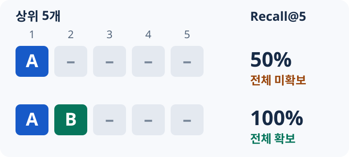
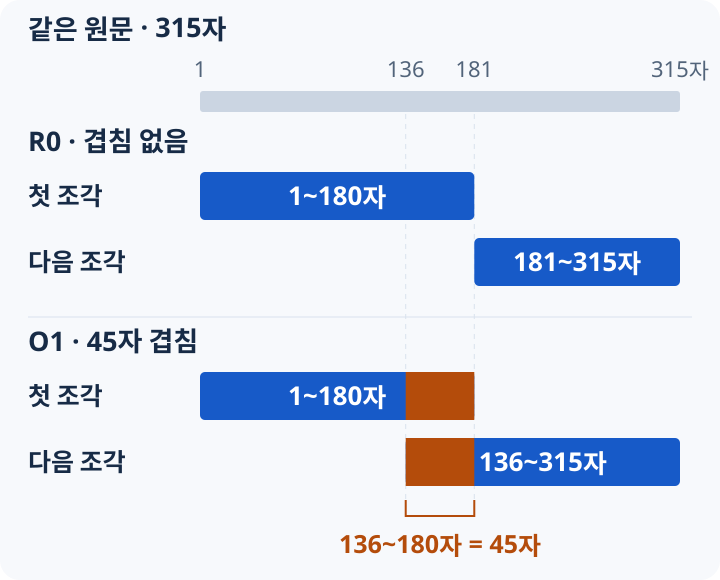
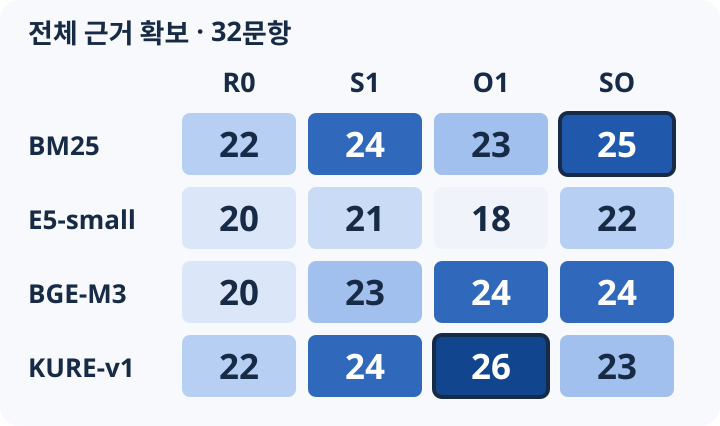
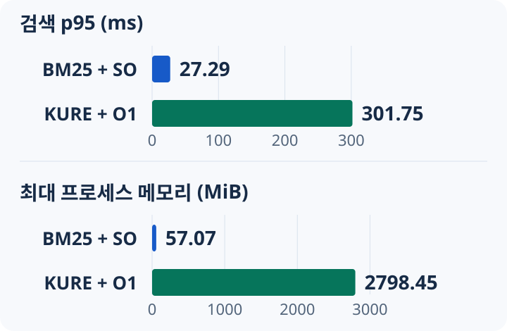

“영양표에는 1회 제공량 기준으로 적혀 있는데, 한 봉지를 다 먹으면 얼마나 먹은 건가요? 두 봉지라면요?”

이 질문에 답하려면 곱셈만 잘해서는 부족해요. 표시된 수치가 무엇을 기준으로 하는지 알아야 해요. 한 봉지에 몇 회 제공량이 들어 있는지도 확인해야 하고요. 필요한 정보가 없다면 무엇을 더 물어야 하는지도 구분해야 해요.

꾸기는 운동과 식단을 기록하는 앱이에요. 우리는 일반 성인의 기초 영양과 영양표 이해를 돕는 RAG를 직접 구현하기로 했어요. RAG는 질문에 관련된 문서를 검색하고, 그 내용을 생성 모델에 근거로 전달하는 방식이에요.

그 첫 단계에서 정한 질문은 이것이었어요.

<strong>답변에 필요한 근거를 검색 결과 상위 5개 안에 모두 담을 수 있을까?</strong>

우리는 키워드 검색인 BM25와 세 임베딩 모델을 비교했어요. 최종적으로는 <strong>BM25에 문장 경계와 겹침을 적용한 청킹 방식인 SO를 결합</strong>했어요. 이번 글은 그 선택에 이르기까지 평가 기준과 검색 단위를 바꿔 가며 확인한 기록이에요.

## 먼저 검색 단계가 책임질 범위를 정했어요

처음부터 회원 기록 조회와 개인별 처방까지 다루지는 않았어요. 첫 코퍼스, 즉 검색 대상 문서 모음은 일반 영양 지식과 영양표 해석으로 제한했어요. 실제 회원 정보도 검색 평가에 넣지 않았어요.

검색과 생성의 평가도 나눴어요. 검색 단계에서는 필요한 근거가 들어왔는지를 확인해요. 생성 단계에서는 그 근거를 정확히 설명하고 인용하는지 확인해요. 관련 문서를 찾았다는 사실만으로 답변이 맞았다고 볼 수는 없으니까요.

실행 조건은 개발 PC의 <strong>CPU 8스레드, 벡터 모델 float32, 질문 배치 1</strong>로 맞췄어요. 검색 모델별로 별도 프로세스를 순서대로 실행했어요.

CPU에서 비교한 이유는 질문을 처리할 때 드는 비용도 선택에 포함해야 했기 때문이에요. 문서 벡터를 미리 만들어도, 새 질문의 벡터는 요청마다 계산해야 해요. 임베딩 모델을 메모리에 올리는 비용도 남아요. 그래서 근거 확보율과 함께 검색 시간과 프로세스 메모리를 기록했어요.

당시에 “검색은 반드시 몇 ms 이내여야 한다”는 운영 합격선이 정해져 있지는 않았어요. 이번 측정은 같은 조건에서 후보의 비용을 비교하기 위한 것이었어요.

## 후보는 키워드 기준선과 세 임베딩 모델이었어요

BM25는 질문과 문서에 나타나는 단어 등을 이용해 점수를 계산해요. 이번 구현은 단어와 한국어 두 글자 조각을 함께 사용했어요. 임베딩 모델은 질문과 문서를 수치 벡터로 바꾼 뒤 가까운 문서를 찾아요.

비교에는 E5-small, BGE-M3, KURE-v1을 사용했어요. 후보를 정할 때의 기대와 실제 결과를 섞지 않으려고, 아래 표에는 이번 실험에서 확인할 비교 축을 정리했어요.

| 후보 | 이번 비교에서 확인할 점 |
| --- | --- |
| BM25 | 모델을 로딩하지 않는 키워드 기준선으로 필요한 근거를 얼마나 찾는가 |
| E5-small | 세 임베딩 후보 중 CPU 실행 비용이 작은 후보가 근거를 얼마나 확보하는가 |
| BGE-M3 | E5-small보다 실행 비용이 큰 후보가 추가로 확보하는 근거가 있는가 |
| KURE-v1 | 다른 임베딩 후보와 비교해 어떤 질문의 근거를 더 찾거나 놓치는가 |

처음에는 출처 5개에서 정리한 요약 문서 24개를 사용했어요. 문서가 짧아서 모두 한 청크에 들어갔어요. 청크는 문서를 나눈 검색 단위예요. 개발 질문 20개 중 답변 가능한 16개로 검색 품질을 측정했어요.

결과는 네 방식 모두 <strong>Recall@5 100%</strong>였어요. BGE-M3와 KURE-v1은 첫 근거 순위 지표가 더 높았지만, 상위 5개에서 확보한 근거의 비율은 같았어요.

이 결과로 바로 고르기는 어려웠어요. 짧은 문서 24개와 질문 16개만으로는 긴 문서의 일부를 놓치는 문제를 확인하기 어려웠기 때문이에요. 그래서 문서와 질문을 늘렸어요.

## “관련된 것 하나”와 “필요한 것 전부”를 나눠 봤어요

예를 들어 어떤 질문에 필수 근거 그룹이 두 개 있다고 해 볼게요. 하나는 제공량의 뜻이고, 다른 하나는 포장 전체로 환산하는 규칙이에요. 이는 지표를 설명하기 위한 예시예요.

상위 5개에서 첫 번째 근거만 찾았다면, 필요한 근거의 절반은 확보했어요. 하지만 답변에 필요한 근거 전체를 찾지는 못했어요. 첫 번째 근거가 1위에 나왔더라도 마찬가지예요.

| 지표 | 이번 평가에서의 의미 |
| --- | --- |
| Recall@5 | 질문마다 필수 근거 그룹 중 확보한 비율을 구한 뒤, 그 비율을 질문 전체에서 평균해요 |
| 전체 근거 확보@5 | 모든 필수 근거 그룹을 확보한 질문 수를 세요. 분모는 답변 가능한 질문 수예요 |
| MRR@5 | 상위 5개에서 처음 완전한 근거 그룹을 확보한 순위의 역수를 평균해요. 없으면 0이에요 |

앞의 예시에서는 Recall@5가 50%지만, 전체 근거 확보는 실패예요. MRR은 첫 근거의 순위를 설명하므로 나머지 근거의 누락을 드러내지 못할 수 있어요.

*필수 근거는 A(제공량의 뜻)와 B(환산 규칙)예요. 두 경우 모두 첫 근거는 1위지만, 아래쪽만 전체를 확보했어요. 실제 평가 문항이 아닌 예시예요.*

채점할 때는 같은 문서가 검색됐는지만 보지 않았어요. 정답표에 등록한 근거 구간이 온전히 들어왔는지를 확인했어요. 한 그룹에 여러 대안이 있으면 그중 완전한 대안 하나가 필요했어요. 대안에 여러 구간이 필요하면 그 구간을 모두 확보해야 했고요.

범위 밖이나 자료 부족 질문은 검색 지표의 분모에서 제외했어요. 이 단계에서는 답변을 생성하지 않았으므로, 제외한 질문에 잘 응답하거나 거절했는지도 평가하지 않았어요.

## 문서를 늘리자 모델뿐 아니라 청킹도 중요해졌어요

요약 문서 24개에 긴 문서 6개를 더해 총 30개로 늘렸어요. 문서를 고정 180자씩 나누니 청크가 55개가 됐어요.

문서 확장이 기존 질문에 미치는 영향은 기존 답변 가능 16문항으로 확인했어요. 새로 만든 답변 가능 32문항은 별도로 평가했어요. 새 질문에는 동의어, 생략, 비슷한 개념의 구별, 여러 근거의 결합을 넣었어요. 두 질문 집합은 합쳐 평균내지 않았어요.

고정 180자 청킹에서 신규 32문항의 전체 근거 확보는 BM25와 KURE-v1이 각각 22/32였어요. E5-small과 BGE-M3는 각각 20/32였어요.

필요한 문서가 검색돼도 필요한 문장 전체가 들어오지 않는 경우가 있었어요. BGE-M3의 한 질문에서는 상위 5개가 모두 같은 문서의 청크였어요. 그 결과 함께 필요한 다른 문서의 근거가 빠졌어요.

이 관찰을 바탕으로 청킹과 검색 결과 선택 규칙을 비교했어요. 청크 경계만이 실패 원인이라고 단정한 것은 아니에요. 질문 난도와 문서 표현도 함께 영향을 주므로, 같은 평가 자료에서 변경 효과를 확인했어요.

| 정책 | 방법 |
| --- | --- |
| R0 | 고정 180자씩 나누고 겹치지 않아요 |
| S1 | 완전한 문장을 최대 180자까지 묶어요 |
| O1 | 고정 180자로 나누되 앞 청크와 45자를 겹쳐요 |
| SO | 문장 경계를 지키면서 완전한 문장 단위로 겹침을 만들어요 |

SO의 겹침 목표는 45자예요. 다만 문장을 잘라 길이를 맞추지는 않아요. 최대 180자와 다음 문장 추가를 우선하므로 실제 겹침은 달라질 수 있어요. 문장 하나가 상한보다 길면 나누는 예외도 있어요.

청크는 검색기가 따로 저장하고 순위를 매기는 원문 조각이에요. 아래는 315자 원문을 고정 길이로 나누는 예시예요. 두 방식 모두 첫 조각은 1–180자예요. 겹침이 없으면 다음 조각은 181자부터 시작해요. 45자를 겹치면 다음 조각은 136자부터 시작하므로, 136–180자가 두 조각에 함께 들어가요.

*가로 위치는 원문에서의 위치예요. 주황색은 두 조각에 공통으로 들어가는 같은 45자예요. O1은 180자씩 읽되 시작 위치를 135자씩 옮겨요. 마지막에 남은 길이가 짧으면 그만큼만 담아요.*

신규 답변 가능 32문항에서의 전체 근거 확보 결과는 다음과 같았어요.

*색이 진할수록 전체 근거를 확보한 질문이 많아요. 모든 칸의 분모는 신규 개발 답변 가능 32문항이며, 테두리는 최종 비교에 남긴 두 조합이에요.*

문장 경계와 겹침을 함께 적용한다고 모든 모델이 좋아지지는 않았어요. BM25는 SO에서 가장 많이 확보했지만, KURE-v1은 O1에서 가장 좋았어요. 그래서 최종 비교 후보도 <strong>BM25+SO와 KURE+O1이라는 두 조합</strong>으로 정했어요.

SO에도 비용은 있었어요. 문장 경계만 적용했을 때보다 청크가 60개에서 80개로 늘었어요. 같은 결합 비교에서 BM25의 신규 질문 검색 시간 p50도 8.70ms에서 16.54ms로 늘었어요. 근거 확보가 늘었다고 비용이 사라지는 것은 아니었어요.

같은 문서가 결과를 차지하는 문제를 줄이려고 문서당 최대 2청크 제한도 별도로 실험했어요. 하지만 필요한 구간을 담으려면 한 문서에서 최소 3청크가 필요한 질문이 있었어요. 이 규칙은 그 근거 조합을 막았어요. 따라서 최종 두 후보에는 문서별 제한을 적용하지 않았어요.

## 마지막 질문 7개에서는 점수와 원문을 함께 읽었어요

후보를 비교한 개발 질문과 별도로 보존해 둔 최종 질문 10개를 사용했어요. 그중 답변 가능한 7개가 검색 지표의 분모였어요. 두 회차를 실행했지만 독립 질문이 14개로 늘어나는 것은 아니에요.

| 지표 | BM25+SO | KURE+O1 |
| --- | ---: | ---: |
| 전체 근거 확보@5 | 7/7 | 6/7 |
| Recall@5 | 100% | 85.71% |
| MRR@5 | 0.8571 | 0.8571 |
| 검색 p50 / p95 | 17.53 / 27.29ms | 137.80 / 301.75ms |
| 최대 프로세스 메모리 | 57.07MiB | 2798.45MiB |

시간은 질문별 준비 실행 후 5회씩, 두 회차에서 얻은 후보당 70개 표본을 통합한 값이에요. 벡터 검색 시간에는 질문 임베딩, 벡터 비교, 정렬이 들어가요. BM25에는 전처리와 점수 계산이 들어가요. 모델 로딩과 문서 인덱스 구축 시간은 제외했어요. 메모리는 로딩을 포함한 프로세스 최대 사용량이에요.

이 PC에서는 회차 사이 시간 변동이 컸어요. 따라서 이 숫자는 운영 응답 시간을 보장하는 수치가 아니에요. 생성까지 포함한 전체 답변 시간도 아니고요.

*시간과 메모리는 서로 다른 단위라 패널을 나눴어요. 검색 시간은 모델 로딩과 문서 인덱스 구축을 제외하고, 메모리는 로딩을 포함한 프로세스 최대값이에요.*

자동 점수만 읽으면 BM25가 한 질문 더 성공했어요. 하지만 그 한 질문은 원문을 함께 봐야 했어요.

FINAL07은 제공량의 표시 단위를 물었어요. KURE는 등록 정답 문서를 6위에 둬서 상위 5개 기준에서 실패했어요. 그런데 3위 청크에도 생활 단위와 질량 단위로 제공량을 표시할 수 있다는 설명이 온전히 있었어요. 그 구간이 정답 대안으로 등록되지 않았던 거예요.

우리는 결과를 본 뒤 점수나 정답표를 바꾸지 않았어요. 대신 이 한계를 기록했어요. <strong>6/7이라는 자동 점수만으로 KURE가 의미상 필요한 설명을 찾지 못했다고 단정할 수는 없어요.</strong>

## BM25+SO를 고른 이유와 이 선택의 범위

개발 신규 질문에서는 KURE+O1이 26/32로 BM25+SO의 25/32보다 한 질문 앞섰어요. 반면 확장 문서에서 기존 질문의 전체 근거 확보는 BM25+SO가 16/16, KURE+O1이 15/16이었어요. 최종 질문의 한 문항 차이에는 앞서 설명한 정답표 한계가 있었어요.

따라서 우리는 이 실험으로 검색 품질의 확정적인 우열을 가리지 않았어요. 현재의 작은 코퍼스에서 확보한 근거와 CPU 실행 비용, 모델 없이 실행할 수 있는 단순성을 함께 고려했어요. 그 결과 2026년 11월 3일 <strong>BM25+SO를 검색 방식으로 확정</strong>했어요. KURE+O1의 결과도 비교 후보로 보존했어요.

확정한 설정은 문장 경계 최대 180자, 완전 문장 겹침 목표 45자, 상위 5개였어요. 문서별 청크 제한이나 재순위화, 키워드·벡터 결과의 결합은 적용하지 않았어요.

이 선택을 “한국어 검색에서는 BM25가 항상 더 좋다”로 확대할 수는 없어요. 사람이 만든 작은 질문 집합이고, 문서와 질문의 표현이 키워드에 유리했을 가능성도 있어요. 이미 확인한 최종 10문항은 다음 조정의 독립 평가셋으로 다시 사용할 수도 없어요.

우리에게 남은 설계 판단은 <strong>모델과 청킹을 함께 비교하고, 필요한 근거 전체를 확보하는지와 실행 비용을 함께 본다</strong>는 것이었어요. 코퍼스나 질문 분포가 달라지면 그 조건에서 다시 확인해야 해요.

## 다음은 찾은 근거로 답하는 문제예요

검색 방식을 고른 뒤에도 생성 모델이 근거를 정확히 사용하고 인용하는지는 별도 평가가 필요했어요. 필요한 값을 모르면 질문을 더 해야 하고, 관련 문장이 있어도 그 문장이 실제 주장을 뒷받침하는지 확인해야 해요.

후속 고정 생성 평가에서는 `gpt-5.4-mini-2026-03-17`을 `reasoning none`으로 사용했어요.

다음 글에서는 생성 단계의 요구사항과 사용한 설정, 실제로 검증한 범위를 나눠 다룰 예정이에요. 이후 진행한 로컬 생성 모델 실험도 당시의 검색 모델 선택과 구분해서 설명하려고 해요.
